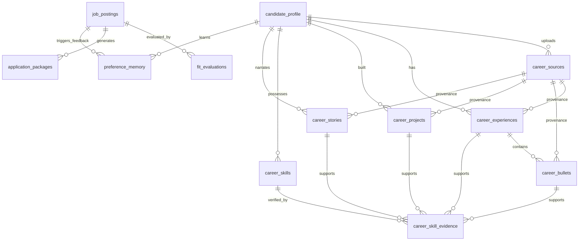

# Session 1 Detailed Design: Database Schema & Master Career Graph Architecture (`packages/db`)

**Status:** Finalized & Approved (v2.0 — 768-dim Embeddings, Universal `pgvector` + `tsvector` GIN Hybrid Search, & Stateless PDF Storage)  
**Parent Spec:** [spec.md](file:///Users/amirhf/job_assist/spec.md)  
**Target Package:** `packages/db` (with shared Zod contracts used by `packages/agents`)

---

## 1. Architectural Overview & Design Decisions

### 1.1 Key Design Principles
1. **Atomic Decomposition for Granular Retrieval:** Rather than storing a resume as a monolithic blob or coarse job descriptions, `career_experiences` (role context) and `career_bullets` (individual achievement statements with verified metrics) are separated into distinct tables. Each atomic block carries its own vector embedding and full-text search index so `selectCareerBlocks` (Module 4) can cherry-pick the exact 4–6 bullets per role that best match a target posting.
2. **Evidence-Backed Skill Graph (Zero-Hallucination Invariant):** Every entry in `career_skills` is linked to one or more concrete records (`career_experiences`, `career_bullets`, `career_projects`, or `career_stories`) through the `career_skill_evidence` join table. During synthesis, the agent is only permitted to claim proficiency in a skill if a verified row exists in `career_skill_evidence` or the user explicitly resolves a gap via `ADDED_TO_PROFILE` or `BRIDGED`.
3. **Serverless-Compatible Hybrid Search (`pgvector` HNSW + Native Postgres `tsvector` GIN Default, `pg_search` Optional):** To ensure $0/mo deployment compatibility with managed serverless PostgreSQL 17 providers (Neon, Supabase, Railway, RDS) as well as local Docker (`pgvector/pgvector:pg17`), the default hybrid search combines `pgvector` (768-dim HNSW cosine similarity) with native PostgreSQL `tsvector` generated columns + `GIN` indexes (`ts_rank_cd`) via Reciprocal Rank Fusion ($k=60$). ParadeDB `pg_search` BM25 remains supported as an optional self-hosted flag.
4. **Stateless Immutable Application Snapshots:** `application_packages` supports iterative drafting in the Studio (`is_immutable_snapshot = false`) and locks an immutable snapshot (`is_immutable_snapshot = true`) when a role transitions to `APPLIED`. Compiled vector PDFs (`~25–45 KB`) are stored statelessly via `storage_provider` (`postgres` base64/bytea by default, or Cloudflare R2 object keys) so Next.js and Trigger.dev workers require zero shared disk volumes.

### 1.2 Entity-Relationship Diagram



---

## 2. Drizzle ORM Schema Specification (`packages/db/src/schema/`)

### 2.1 Shared Enums & Vector Configuration (`enums.ts`)

We standardize on **768 dimensions** (compatible across `gemini-embedding-001`, `text-embedding-004`, `text-embedding-3-small` with `dimensions: 768`, and local open-weight models like `nomic-embed-text-v1.5` / `bge-base-en-v1.5`) for `vector(768)` columns.

```typescript
// packages/db/src/schema/enums.ts
import { pgEnum } from 'drizzle-orm/pg-core';

export const EMBEDDING_DIMENSIONS = 768;

export const jobStatusEnum = pgEnum('job_status', [
  'INGESTED',           // Raw posting fetched, awaiting Stage 1 filter
  'FILTERED_OUT',       // Failed Stage 1 deterministic hard filters
  'TRIAGE_INBOX',       // Passed Stage 1 + Stage 2 scored; awaiting human review (Surface A)
  'REJECTED',           // Rejected by user in Triage Inbox or Studio (feeds preference_memory)
  'APPROVED',           // Approved by user; queued in Surface B awaiting generation trigger
  'GENERATING',         // Async Trigger.dev + Mastra workflow actively running
  'PAUSED_NEEDS_INPUT', // Workflow suspended on critical skill gap awaiting user resolution
  'READY_TO_APPLY',     // Materials compiled & audited; ready in Surface C Studio
  'APPLYING',           // Stagehand v4 local headed session currently active
  'APPLIED',            // Confirmed submitted; immutable snapshot archived in Surface D
  'ARCHIVED',           // Closed, expired, or withdrawn
]);

export const remotePolicyEnum = pgEnum('remote_policy', [
  'REMOTE_GLOBAL',
  'REMOTE_COUNTRY_LOCKED',
  'REMOTE_TIMEZONE_LOCKED',
  'HYBRID',
  'ONSITE',
  'UNKNOWN',
]);

export const skillCategoryEnum = pgEnum('skill_category', [
  'LANGUAGE',
  'FRAMEWORK_LIBRARY',
  'DATABASE_STORAGE',
  'CLOUD_INFRASTRUCTURE',
  'AI_ML_DATA',
  'ARCHITECTURE_CONCEPT',
  'TOOL_PLATFORM',
  'DOMAIN_INDUSTRY',
  'LEADERSHIP_METHODOLOGY',
]);

export const skillProficiencyEnum = pgEnum('skill_proficiency', [
  'EXPERT',       // Production ownership, deep architectural mastery
  'PROFICIENT',   // Hands-on production shipping experience
  'FAMILIAR',     // Side projects, coursework, or adjacent exposure
]);

export const sourceTypeEnum = pgEnum('career_source_type', [
  'RESUME_UPLOAD',
  'PROJECT_DOC',
  'PORTFOLIO_URL',
  'GITHUB_REPO',
  'GAP_RESOLUTION_PROMPT',
  'MANUAL_UI_ENTRY',
]);

export const gapSeverityEnum = pgEnum('gap_severity', [
  'CRITICAL', // Mandatory knockout/core requirement missing; triggers workflow .suspend()
  'MODERATE', // Important requirement; can be bridged with adjacent skill or inline prompt
  'MINOR',    // Nice-to-have; auto-bridged or safely omitted
]);

export const gapResolutionStatusEnum = pgEnum('gap_resolution_status', [
  'OPEN',
  'ADDED_TO_PROFILE', // User supplied new evidence -> saved to Master Career Graph
  'BRIDGED',          // User instructed agent to emphasize adjacent verified skill
  'IGNORED',          // User chose to proceed without addressing
]);

export const generationStepEnum = pgEnum('generation_step', [
  'QUEUED',
  'ANALYZING_REQUIREMENTS',
  'SELECTING_CAREER_BLOCKS',
  'CHECKING_CRITICAL_GAPS',
  'PAUSED_ON_GAP',
  'SYNTHESIZING_RESUME',
  'SYNTHESIZING_COVER_LETTER_AND_QA',
  'COMPILING_AND_AUDITING_PDF',
  'COMPLETED',
  'FAILED',
]);

export const preferenceTypeEnum = pgEnum('preference_type', [
  'JOB_REJECTION_PATTERN', // Learned from Surface A Reject modal
  'RUBRIC_CALIBRATION',    // Adjustments to scoring sensitivity
  'PHRASING_REPLACEMENT',  // Learned from Studio "Save phrasing to Preference Memory" edits
  'TONE_AND_STYLE_RULE',   // Global writing guardrail (e.g., banned buzzwords, preferred verb style)
]);

export const applyModeEnum = pgEnum('apply_mode', [
  'STAGEHAND_HEADED', // Option B Primary
  'COPY_PASTE_KIT',   // Option A Fallback
  'MANUAL_DIRECT',
]);

export const postApplyStageEnum = pgEnum('post_apply_stage', [
  'APPLIED_AWAITING_RESPONSE',
  'RECRUITER_SCREEN',
  'TECHNICAL_INTERVIEW',
  'FINAL_ROUND',
  'OFFER_RECEIVED',
  'POST_APPLY_REJECTED',
  'WITHDRAWN',
]);
```

---

### 2.2 Master Career Graph Tables (`profile.ts`)

```typescript
// packages/db/src/schema/profile.ts
import {
  pgTable,
  uuid,
  text,
  integer,
  boolean,
  timestamp,
  date,
  jsonb,
  vector,
  index,
  uniqueIndex,
} from 'drizzle-orm/pg-core';
import {
  EMBEDDING_DIMENSIONS,
  remotePolicyEnum,
  skillCategoryEnum,
  skillProficiencyEnum,
  sourceTypeEnum,
} from './enums';

// Typed JSONB shapes for Hard Filters & Rubric Weights
export interface HardFiltersConfig {
  allowedRemotePolicies: Array<'REMOTE_GLOBAL' | 'REMOTE_COUNTRY_LOCKED' | 'REMOTE_TIMEZONE_LOCKED' | 'HYBRID' | 'ONSITE'>;
  allowedCountries: string[];          // ISO-3166 alpha-2 codes, e.g. ["US", "CA"]
  allowedLocations: string[];          // City/Metro allowlist for Hybrid/Onsite, e.g. ["San Francisco, CA", "Seattle, WA"]
  allowedUtcOffsetRange: { min: number; max: number }; // e.g. { min: -8, max: -5 }
  minBaseSalaryUsd: number | null;     // Annual floor in USD; postings stating a max below this fail Stage 1
  allowUnlistedSalary: boolean;        // If true, postings without salary bands pass Stage 1
  requiresVisaSponsorship: boolean;    // If true, postings explicitly stating "No sponsorship" fail Stage 1
  blacklistedCompanies: string[];      // Normalized company names
  blacklistedTitleKeywords: string[];  // e.g. ["unpaid", "intern", "commission only", "clearance required"]
  blacklistedDescriptionKeywords: string[];
}

export interface RubricWeightsConfig {
  techStackAlignment: number; // 0-100 (default: 35)
  seniorityAndScope: number;  // 0-100 (default: 25)
  domainIndustryFit: number;  // 0-100 (default: 20)
  companyStageCulture: number;// 0-100 (default: 20)
}

export interface QuantifiedMetric {
  metric: string;       // e.g. "p99 API latency", "ARR growth", "deployment time"
  value: string;        // e.g. "42%", "$1.8M", "3.5x"
  context?: string;     // e.g. "from 850ms to 490ms across 12 microservices"
  isExactFromSource: boolean; // True if verbatim from user document; never inferred by LLM
}

// 1. Candidate Profile & Global Search/Rubric Config
export const candidateProfile = pgTable('candidate_profile', {
  id: uuid('id').defaultRandom().primaryKey(),
  fullName: text('full_name').notNull(),
  headline: text('headline').notNull(),
  email: text('email').notNull(),
  phone: text('phone'),
  locationCity: text('location_city').notNull(),
  locationCountry: text('location_country').notNull().default('US'),
  timezoneIana: text('timezone_iana').notNull().default('America/Los_Angeles'),
  utcOffsetHours: integer('utc_offset_hours').notNull().default(-8),
  links: jsonb('links').$type<{
    linkedinUrl?: string;
    githubUrl?: string;
    portfolioUrl?: string;
    scholarUrl?: string;
    otherUrls?: Array<{ label: string; url: string }>;
  }>().notNull().default({}),
  workAuthorization: jsonb('work_authorization').$type<{
    authorizedCountries: string[];
    requiresSponsorship: boolean;
    visaStatusNote?: string;
  }>().notNull(),
  executiveBio: text('executive_bio'),
  totalYearsExperience: integer('total_years_experience').notNull().default(0),
  targetRoles: jsonb('target_roles').$type<string[]>().notNull().default([]),
  hardFilters: jsonb('hard_filters').$type<HardFiltersConfig>().notNull(),
  rubricWeights: jsonb('rubric_weights').$type<RubricWeightsConfig>().notNull(),
  createdAt: timestamp('created_at', { withTimezone: true }).defaultNow().notNull(),
  updatedAt: timestamp('updated_at', { withTimezone: true }).defaultNow().notNull(),
});

// 2. Provenance / Uploaded Sources
export const careerSources = pgTable('career_sources', {
  id: uuid('id').defaultRandom().primaryKey(),
  profileId: uuid('profile_id').references(() => candidateProfile.id, { onDelete: 'cascade' }).notNull(),
  sourceType: sourceTypeEnum('source_type').notNull(),
  title: text('title').notNull(), // Filename, repo name, or URL
  sourceUrlOrPath: text('source_url_or_path'),
  rawMarkdownContent: text('raw_markdown_content').notNull(),
  contentHash: text('content_hash').notNull(), // SHA-256 to prevent duplicate re-ingestion
  metadata: jsonb('metadata').$type<Record<string, unknown>>().default({}),
  ingestedAt: timestamp('ingested_at', { withTimezone: true }).defaultNow().notNull(),
}, (table) => [
  uniqueIndex('career_sources_profile_hash_idx').on(table.profileId, table.contentHash),
]);

// 3. Career Experiences (Role-Level Context)
export const careerExperiences = pgTable('career_experiences', {
  id: uuid('id').defaultRandom().primaryKey(),
  profileId: uuid('profile_id').references(() => candidateProfile.id, { onDelete: 'cascade' }).notNull(),
  sourceId: uuid('source_id').references(() => careerSources.id, { onDelete: 'set null' }),
  companyName: text('company_name').notNull(),
  normalizedCompanyName: text('normalized_company_name').notNull(),
  jobTitle: text('job_title').notNull(),
  employmentType: text('employment_type').default('FULL_TIME').notNull(), // FULL_TIME, CONTRACT, FOUNDER, ADVISORY
  location: text('location'),
  remotePolicy: remotePolicyEnum('remote_policy').default('UNKNOWN'),
  startDate: date('start_date').notNull(),
  endDate: date('end_date'), // null if isCurrent = true
  isCurrent: boolean('is_current').default(false).notNull(),
  companyStageAndContext: text('company_stage_and_context'), // e.g. "Series B AI FinTech, 120 engineers"
  roleOverview: text('role_overview').notNull(), // High-level scope, team size, reporting line
  domainTags: jsonb('domain_tags').$type<string[]>().notNull().default([]),
  primaryTechStack: jsonb('primary_tech_stack').$type<string[]>().notNull().default([]),
  displayOrder: integer('display_order').notNull().default(0),
  embedding: vector('embedding', { dimensions: EMBEDDING_DIMENSIONS }),
  createdAt: timestamp('created_at', { withTimezone: true }).defaultNow().notNull(),
  updatedAt: timestamp('updated_at', { withTimezone: true }).defaultNow().notNull(),
}, (table) => [
  index('career_experiences_profile_idx').on(table.profileId),
  index('career_experiences_embedding_hnsw_idx').using('hnsw', table.embedding.op('vector_cosine_ops')),
]);

// 4. Atomic Achievement Bullets (Granular Retrieval Units)
export const careerBullets = pgTable('career_bullets', {
  id: uuid('id').defaultRandom().primaryKey(),
  profileId: uuid('profile_id').references(() => candidateProfile.id, { onDelete: 'cascade' }).notNull(),
  experienceId: uuid('experience_id').references(() => careerExperiences.id, { onDelete: 'cascade' }).notNull(),
  sourceId: uuid('source_id').references(() => careerSources.id, { onDelete: 'set null' }),
  bulletText: text('bullet_text').notNull(), // Canonical verified statement
  actionVerb: text('action_verb').notNull(),
  situationAndTask: text('situation_and_task'), // Context behind the bullet
  technicalApproach: text('technical_approach'), // How it was built/solved
  quantifiedMetrics: jsonb('quantified_metrics').$type<QuantifiedMetric[]>().notNull().default([]),
  hasVerifiedMetric: boolean('has_verified_metric').default(false).notNull(),
  skillTags: jsonb('skill_tags').$type<string[]>().notNull().default([]),
  impactScore: integer('impact_score').default(50).notNull(), // 1-100 baseline strength rating
  isFeatured: boolean('is_featured').default(false).notNull(),
  displayOrder: integer('display_order').notNull().default(0),
  embedding: vector('embedding', { dimensions: EMBEDDING_DIMENSIONS }),
  createdAt: timestamp('created_at', { withTimezone: true }).defaultNow().notNull(),
  updatedAt: timestamp('updated_at', { withTimezone: true }).defaultNow().notNull(),
}, (table) => [
  index('career_bullets_experience_idx').on(table.experienceId),
  index('career_bullets_embedding_hnsw_idx').using('hnsw', table.embedding.op('vector_cosine_ops')),
]);

// 5. Career Projects (Open-Source, Capstones, Deep Technical Systems)
export const careerProjects = pgTable('career_projects', {
  id: uuid('id').defaultRandom().primaryKey(),
  profileId: uuid('profile_id').references(() => candidateProfile.id, { onDelete: 'cascade' }).notNull(),
  sourceId: uuid('source_id').references(() => careerSources.id, { onDelete: 'set null' }),
  linkedExperienceId: uuid('linked_experience_id').references(() => careerExperiences.id, { onDelete: 'set null' }),
  projectName: text('project_name').notNull(),
  tagline: text('tagline').notNull(),
  problemStatement: text('problem_statement').notNull(),
  architectureAndStack: text('architecture_and_stack').notNull(),
  quantifiedOutcomes: jsonb('quantified_outcomes').$type<QuantifiedMetric[]>().notNull().default([]),
  highlightBullets: jsonb('highlight_bullets').$type<string[]>().notNull().default([]),
  techStackTags: jsonb('tech_stack_tags').$type<string[]>().notNull().default([]),
  repositoryUrl: text('repository_url'),
  liveDemoUrl: text('live_demo_url'),
  startDate: date('start_date'),
  endDate: date('end_date'),
  embedding: vector('embedding', { dimensions: EMBEDDING_DIMENSIONS }),
  createdAt: timestamp('created_at', { withTimezone: true }).defaultNow().notNull(),
  updatedAt: timestamp('updated_at', { withTimezone: true }).defaultNow().notNull(),
}, (table) => [
  index('career_projects_profile_idx').on(table.profileId),
  index('career_projects_embedding_hnsw_idx').using('hnsw', table.embedding.op('vector_cosine_ops')),
]);

// 6. STAR Stories (Behavioral & Custom Screening Narratives)
export const careerStories = pgTable('career_stories', {
  id: uuid('id').defaultRandom().primaryKey(),
  profileId: uuid('profile_id').references(() => candidateProfile.id, { onDelete: 'cascade' }).notNull(),
  sourceId: uuid('source_id').references(() => careerSources.id, { onDelete: 'set null' }),
  linkedExperienceId: uuid('linked_experience_id').references(() => careerExperiences.id, { onDelete: 'set null' }),
  linkedProjectId: uuid('linked_project_id').references(() => careerProjects.id, { onDelete: 'set null' }),
  title: text('title').notNull(), // e.g. "Migrating monolith to event-driven pipeline under tight deadline"
  situation: text('situation').notNull(),
  task: text('task').notNull(),
  action: text('action').notNull(),
  result: text('result').notNull(),
  quantifiedMetrics: jsonb('quantified_metrics').$type<QuantifiedMetric[]>().notNull().default([]),
  themes: jsonb('themes').$type<string[]>().notNull().default([]), // e.g. ["conflict_resolution", "scaling", "ambiguity", "incident_response"]
  embedding: vector('embedding', { dimensions: EMBEDDING_DIMENSIONS }),
  createdAt: timestamp('created_at', { withTimezone: true }).defaultNow().notNull(),
  updatedAt: timestamp('updated_at', { withTimezone: true }).defaultNow().notNull(),
}, (table) => [
  index('career_stories_profile_idx').on(table.profileId),
  index('career_stories_embedding_hnsw_idx').using('hnsw', table.embedding.op('vector_cosine_ops')),
]);

// 7. Normalized Career Skills
export const careerSkills = pgTable('career_skills', {
  id: uuid('id').defaultRandom().primaryKey(),
  profileId: uuid('profile_id').references(() => candidateProfile.id, { onDelete: 'cascade' }).notNull(),
  name: text('name').notNull(),             // Display name, e.g. "PostgreSQL"
  normalizedSlug: text('normalized_slug').notNull(), // Lowercase canonical slug, e.g. "postgresql"
  aliases: jsonb('aliases').$type<string[]>().notNull().default([]), // e.g. ["postgres", "pg", "pgvector"]
  category: skillCategoryEnum('category').notNull(),
  proficiency: skillProficiencyEnum('proficiency').notNull().default('PROFICIENT'),
  yearsOfExperience: integer('years_of_experience'),
  lastUsedYear: integer('last_used_year'),
  adjacentSkillSlugs: jsonb('adjacent_skill_slugs').$type<string[]>().notNull().default([]), // Used for bridging minor gaps
  isUserVerified: boolean('is_user_verified').default(true).notNull(),
  embedding: vector('embedding', { dimensions: EMBEDDING_DIMENSIONS }),
  createdAt: timestamp('created_at', { withTimezone: true }).defaultNow().notNull(),
  updatedAt: timestamp('updated_at', { withTimezone: true }).defaultNow().notNull(),
}, (table) => [
  uniqueIndex('career_skills_profile_slug_idx').on(table.profileId, table.normalizedSlug),
  index('career_skills_embedding_hnsw_idx').using('hnsw', table.embedding.op('vector_cosine_ops')),
]);

// 8. Skill Evidence Links (Enforces Zero Hallucination)
export const careerSkillEvidence = pgTable('career_skill_evidence', {
  id: uuid('id').defaultRandom().primaryKey(),
  skillId: uuid('skill_id').references(() => careerSkills.id, { onDelete: 'cascade' }).notNull(),
  experienceId: uuid('experience_id').references(() => careerExperiences.id, { onDelete: 'cascade' }),
  bulletId: uuid('bullet_id').references(() => careerBullets.id, { onDelete: 'cascade' }),
  projectId: uuid('project_id').references(() => careerProjects.id, { onDelete: 'cascade' }),
  storyId: uuid('story_id').references(() => careerStories.id, { onDelete: 'cascade' }),
  verbatimEvidenceExcerpt: text('verbatim_evidence_excerpt').notNull(), // Exact quote/context proving skill usage
  createdAt: timestamp('created_at', { withTimezone: true }).defaultNow().notNull(),
}, (table) => [
  index('career_skill_evidence_skill_idx').on(table.skillId),
]);
```

---

### 2.3 Job Postings & Fit Evaluation Tables (`jobs.ts`)

```typescript
// packages/db/src/schema/jobs.ts
import {
  pgTable,
  uuid,
  text,
  integer,
  boolean,
  timestamp,
  jsonb,
  vector,
  index,
  uniqueIndex,
} from 'drizzle-orm/pg-core';
import {
  EMBEDDING_DIMENSIONS,
  jobStatusEnum,
  remotePolicyEnum,
  gapSeverityEnum,
  gapResolutionStatusEnum,
} from './enums';

export interface JobPostingSourceEntry {
  connector: 'SERPAPI_GOOGLE_JOBS' | 'REMOTIVE' | 'ATS_DIRECT_SEARCH' | 'GMAIL_ALERT' | 'MANUAL_URL';
  sourceUrl: string;
  externalId?: string;
  discoveredAt: string; // ISO timestamp
}

export interface ExtractedApplicationQuestion {
  questionId: string;   // Deterministic hash of label
  label: string;        // Exact form prompt
  fieldType: 'SHORT_TEXT' | 'LONG_TEXT' | 'SINGLE_SELECT' | 'MULTI_SELECT' | 'BOOLEAN' | 'NUMBER' | 'FILE_UPLOAD' | 'URL';
  required: boolean;
  options?: string[];   // For select/radio fields
  maxLength?: number;
  placeholderOrHint?: string;
  selectorHint?: string; // Optional accessibility role/label hint for Stagehand v4
}

export interface SpecialPostingInstruction {
  instructionType: 'EASTER_EGG_PHRASE' | 'COVER_LETTER_PROMPT' | 'FORMATTING_RULE' | 'SUBJECT_LINE';
  exactRequirement: string; // e.g. "Include the phrase 'blue banana' in the second paragraph of your cover letter"
  sourceQuote: string;
}

export interface FlaggedSkillGap {
  gapId: string;
  requirementText: string;      // Requirement as stated in the job posting
  missingSkillName: string;     // Normalized skill/qualification missing from Master Career Graph
  severity: 'CRITICAL' | 'MODERATE' | 'MINOR';
  adjacentVerifiedSkills: Array<{
    skillId: string;
    skillName: string;
    rationale: string;          // Why this verified skill bridges the gap
  }>;
  resolutionStatus: 'OPEN' | 'ADDED_TO_PROFILE' | 'BRIDGED' | 'IGNORED';
  resolutionNote?: string;      // User's bridging note or newly added experience context
  createdCareerSkillId?: string;// Populated when resolutionStatus === 'ADDED_TO_PROFILE'
  resolvedAt?: string;
}

// 9. Job Postings
export const jobPostings = pgTable('job_postings', {
  id: uuid('id').defaultRandom().primaryKey(),
  dedupFingerprint: text('dedup_fingerprint').notNull(), // sha256(normalized_company + "::" + normalized_title + "::" + location_bucket)
  companyName: text('company_name').notNull(),
  normalizedCompanyName: text('normalized_company_name').notNull(),
  title: text('title').notNull(),
  normalizedTitle: text('normalized_title').notNull(),
  locationRaw: text('location_raw').notNull(),
  locationBucket: text('location_bucket').notNull(), // e.g. "us-remote", "sf-bay-area", "nyc"
  countryCode: text('country_code').default('US'),
  remotePolicy: remotePolicyEnum('remote_policy').default('UNKNOWN').notNull(),
  allowedUtcOffsetRange: jsonb('allowed_utc_offset_range').$type<{ min?: number; max?: number }>(),
  salaryMinUsd: integer('salary_min_usd'),
  salaryMaxUsd: integer('salary_max_usd'),
  salaryRawText: text('salary_raw_text'),
  offersVisaSponsorship: boolean('offers_visa_sponsorship'), // null if unstated
  atsPlatform: text('ats_platform'), // 'GREENHOUSE' | 'LEVER' | 'ASHBY' | 'WORKDAY' | 'CUSTOM'
  applicationUrl: text('application_url').notNull(),
  sources: jsonb('sources').$type<JobPostingSourceEntry[]>().notNull().default([]),
  rawDescriptionHtml: text('raw_description_html'),
  cleanDescriptionMarkdown: text('clean_description_markdown').notNull(),
  extractedRequirements: jsonb('extracted_requirements').$type<{
    mustHaveSkills: string[];
    niceToHaveSkills: string[];
    minYearsExperience?: number;
    seniorityLevel?: string;
    domainKeywords: string[];
  }>().notNull().default({ mustHaveSkills: [], niceToHaveSkills: [], domainKeywords: [] }),
  extractedQuestions: jsonb('extracted_questions').$type<ExtractedApplicationQuestion[]>().notNull().default([]),
  requiredAttachments: jsonb('required_attachments').$type<{
    resume: boolean;
    coverLetter: 'REQUIRED' | 'OPTIONAL' | 'NONE';
    portfolioUrl: boolean;
    otherFiles: string[];
  }>().notNull().default({ resume: true, coverLetter: 'OPTIONAL', portfolioUrl: false, otherFiles: [] }),
  specialInstructions: jsonb('special_instructions').$type<SpecialPostingInstruction[]>().notNull().default([]),
  status: jobStatusEnum('status').default('INGESTED').notNull(),
  rejectionReasonCategory: text('rejection_reason_category'), // e.g. "COMPENSATION_TOO_LOW", "WRONG_TECH_STACK", "COMPANY_DOMAIN"
  rejectionUserNotes: text('rejection_user_notes'),
  embedding: vector('embedding', { dimensions: EMBEDDING_DIMENSIONS }),
  postedAt: timestamp('posted_at', { withTimezone: true }),
  ingestedAt: timestamp('ingested_at', { withTimezone: true }).defaultNow().notNull(),
  updatedAt: timestamp('updated_at', { withTimezone: true }).defaultNow().notNull(),
}, (table) => [
  uniqueIndex('job_postings_dedup_fingerprint_idx').on(table.dedupFingerprint),
  index('job_postings_status_idx').on(table.status),
  index('job_postings_company_idx').on(table.normalizedCompanyName),
  index('job_postings_embedding_hnsw_idx').using('hnsw', table.embedding.op('vector_cosine_ops')),
]);

// 10. Two-Stage Fit Evaluations
export const fitEvaluations = pgTable('fit_evaluations', {
  id: uuid('id').defaultRandom().primaryKey(),
  jobPostingId: uuid('job_posting_id').references(() => jobPostings.id, { onDelete: 'cascade' }).notNull(),
  // Stage 1: Deterministic Gate
  stage1Passed: boolean('stage1_passed').notNull(),
  stage1KnockoutReasons: jsonb('stage1_knockout_reasons').$type<Array<{
    rule: string;
    expected: string;
    actual: string;
  }>>().notNull().default([]),
  // Stage 2: Weighted LLM Rubric Scoring
  overallScore: integer('overall_score'), // 0-100, null if stage1Passed === false
  categoryScores: jsonb('category_scores').$type<{
    techStackAlignment: { score: number; weight: number; rationale: string };
    seniorityAndScope: { score: number; weight: number; rationale: string };
    domainIndustryFit: { score: number; weight: number; rationale: string };
    companyStageCulture: { score: number; weight: number; rationale: string };
  }>(),
  executiveSummary: text('executive_summary'), // Concise bulleted synthesis for Surface A Triage Inbox
  topMatchedBlockIds: jsonb('top_matched_block_ids').$type<{
    experienceIds: string[];
    bulletIds: string[];
    projectIds: string[];
    skillIds: string[];
  }>().default({ experienceIds: [], bulletIds: [], projectIds: [], skillIds: [] }),
  flaggedGaps: jsonb('flagged_gaps').$type<FlaggedSkillGap[]>().notNull().default([]),
  hasUnresolvedCriticalGap: boolean('has_unresolved_critical_gap').default(false).notNull(),
  evaluatorModelUsed: text('evaluator_model_used'), // e.g. "gemini-3.5-flash"
  evaluatedAt: timestamp('evaluated_at', { withTimezone: true }).defaultNow().notNull(),
}, (table) => [
  uniqueIndex('fit_evaluations_job_posting_idx').on(table.jobPostingId),
  index('fit_evaluations_overall_score_idx').on(table.overallScore),
]);
```

---

### 2.4 Application Packages & Preference Memory Tables (`applications.ts` & `memory.ts`)

```typescript
// packages/db/src/schema/applications.ts
import {
  pgTable,
  uuid,
  text,
  integer,
  boolean,
  timestamp,
  jsonb,
  index,
} from 'drizzle-orm/pg-core';
import { jobPostings } from './jobs';
import { generationStepEnum, applyModeEnum } from './enums';

export interface TailoredResumePayload {
  targetHeadline: string;
  executiveSummary: string;
  selectedExperiences: Array<{
    experienceId: string;
    companyName: string;
    jobTitle: string;
    dateRangeText: string;
    locationText: string;
    tailoredBullets: Array<{
      sourceBulletId: string; // Traceability back to career_bullets.id
      originalText: string;
      tailoredText: string;
      bridgedSkillNote?: string;
    }>;
  }>;
  selectedProjects: Array<{
    projectId: string;
    projectName: string;
    tailoredSummary: string;
    tailoredHighlights: string[];
  }>;
  categorizedSkills: Array<{
    categoryLabel: string;
    skills: string[]; // Each must trace to career_skills
  }>;
}

export interface AnsweredScreeningQuestion {
  questionId: string;
  questionLabel: string;
  fieldType: string;
  draftedAnswer: string;
  userEditedAnswer?: string;
  citedCareerBlockIds: string[]; // IDs of stories/bullets/experiences used as ground truth
  specialInstructionSatisfied?: string;
}

export interface PdfCompilationAudit {
  pageCount: number;
  targetMaxPages: number; // Typically 1 or 2
  overflowDetected: boolean;
  atsKeywordCoveragePercent: number;
  matchedKeywords: string[];
  missingKeywords: string[];
  specialInstructionsVerified: boolean;
  zeroHallucinationAuditPassed: boolean;
  auditWarnings: string[];
}

// 11. Application Packages (Draft Studio + Immutable Applied Snapshots)
export const applicationPackages = pgTable('application_packages', {
  id: uuid('id').defaultRandom().primaryKey(),
  jobPostingId: uuid('job_posting_id').references(() => jobPostings.id, { onDelete: 'cascade' }).notNull(),
  version: integer('version').default(1).notNull(),
  isImmutableSnapshot: boolean('is_immutable_snapshot').default(false).notNull(), // Locked when APPLIED
  // Watchable Async Execution metadata
  triggerRunId: text('trigger_run_id'),
  mastraWorkflowRunId: text('mastra_workflow_run_id'),
  currentStep: generationStepEnum('current_step').default('QUEUED').notNull(),
  streamChannelId: text('stream_channel_id'), // Resumable SSE stream identifier for AI SDK 7
  // Tailored Content & Typst Source
  tailoredResumeData: jsonb('tailored_resume_data').$type<TailoredResumePayload>(),
  resumeTypstSource: text('resume_typst_source'),
  coverLetterMarkdown: text('cover_letter_markdown'),
  coverLetterTypstSource: text('cover_letter_typst_source'),
  screeningQuestionAnswers: jsonb('screening_question_answers').$type<AnsweredScreeningQuestion[]>().notNull().default([]),
  // Compilation & Stateless Artifact Storage
  pdfAudit: jsonb('pdf_audit').$type<PdfCompilationAudit>(),
  storageProvider: text('storage_provider').default('postgres').notNull(), // 'postgres' | 'r2' | 'local-fs'
  compiledResumePdfBase64: text('compiled_resume_pdf_base64'), // Populated when storageProvider === 'postgres' (~30KB)
  compiledCoverLetterPdfBase64: text('compiled_cover_letter_pdf_base64'),
  compiledResumePdfPath: text('compiled_resume_pdf_path'), // R2 object key/URL or local path
  compiledCoverLetterPdfPath: text('compiled_cover_letter_pdf_path'),
  // Assisted Apply & Submission Metadata
  synthesisModelUsed: text('synthesis_model_used').default('claude-sonnet-4-6').notNull(),
  applyMode: applyModeEnum('apply_mode'),
  postApplyStage: postApplyStageEnum('post_apply_stage').default('APPLIED_AWAITING_RESPONSE'),
  stagehandSessionLog: jsonb('stagehand_session_log').$type<{
    filledFieldsCount: number;
    ambiguousFieldsFlagged: string[];
    haltedAtSubmitAt?: string;
  }>(),
  submittedAt: timestamp('submitted_at', { withTimezone: true }),
  createdAt: timestamp('created_at', { withTimezone: true }).defaultNow().notNull(),
  updatedAt: timestamp('updated_at', { withTimezone: true }).defaultNow().notNull(),
}, (table) => [
  index('application_packages_job_posting_idx').on(table.jobPostingId),
  index('application_packages_trigger_run_idx').on(table.triggerRunId),
]);

// 11b. Generation Stream Events (Zero-Redis Resumable SSE Event Log)
export const generationStreamEvents = pgTable('generation_stream_events', {
  id: uuid('id').defaultRandom().primaryKey(),
  packageId: uuid('package_id').references(() => applicationPackages.id, { onDelete: 'cascade' }).notNull(),
  streamChannelId: text('stream_channel_id').notNull(),
  seq: integer('seq').notNull(),
  eventType: text('event_type').notNull(),
  payload: jsonb('payload').$type<Record<string, unknown>>().notNull(),
  createdAt: timestamp('created_at', { withTimezone: true }).defaultNow().notNull(),
}, (table) => [
  index('generation_stream_events_channel_seq_idx').on(table.streamChannelId, table.seq),
]);
```

```typescript
// packages/db/src/schema/memory.ts
import {
  pgTable,
  uuid,
  text,
  real,
  boolean,
  timestamp,
  jsonb,
  vector,
  index,
} from 'drizzle-orm/pg-core';
import { candidateProfile } from './profile';
import { jobPostings } from './jobs';
import { EMBEDDING_DIMENSIONS, preferenceTypeEnum } from './enums';

// 12. Preference Memory (Continuous Self-Improvement Loop)
export const preferenceMemory = pgTable('preference_memory', {
  id: uuid('id').defaultRandom().primaryKey(),
  profileId: uuid('profile_id').references(() => candidateProfile.id, { onDelete: 'cascade' }).notNull(),
  sourceJobPostingId: uuid('source_job_posting_id').references(() => jobPostings.id, { onDelete: 'set null' }),
  preferenceType: preferenceTypeEnum('preference_type').notNull(),
  ruleStatement: text('rule_statement').notNull(), // Distilled instruction, e.g. "Avoid roles focused primarily on legacy PHP maintenance" or "Replace 'spearheaded' with 'architected and shipped'"
  originalTextSnippet: text('original_text_snippet'), // Populated when learned from Studio inline edit
  userEditedTextSnippet: text('user_edited_text_snippet'),
  applicableScopes: jsonb('applicable_scopes').$type<Array<'RUBRIC_SCORING' | 'RESUME_BULLETS' | 'COVER_LETTER' | 'SCREENING_QA'>>().notNull().default([]),
  confidenceWeight: real('confidence_weight').default(1.0).notNull(), // 0.0 to 1.0
  timesApplied: real('times_applied').default(0).notNull(),
  isActive: boolean('is_active').default(true).notNull(),
  embedding: vector('embedding', { dimensions: EMBEDDING_DIMENSIONS }),
  createdAt: timestamp('created_at', { withTimezone: true }).defaultNow().notNull(),
}, (table) => [
  index('preference_memory_profile_type_idx').on(table.profileId, table.preferenceType),
  index('preference_memory_embedding_hnsw_idx').using('hnsw', table.embedding.op('vector_cosine_ops')),
]);
```

---

## 3. Hybrid Retrieval Configuration (`pgvector` HNSW + Native `tsvector` GIN Default, `pg_search` Optional)

### 3.1 Why Hybrid Search Is Critical for Career Graph Retrieval
Pure semantic vector search (`pgvector`) captures conceptual similarity (e.g., matching *"built high-throughput distributed event streaming"* to *"real-time data pipeline architecture"*), but often struggles with exact token discrimination (e.g., distinguishing `Next.js 16` vs `Nuxt.js`, `pgvector` vs `Pinecone`, or exact compliance codes like `SOC2` / `HIPAA`). Combining `pgvector` HNSW cosine distance with lexical full-text scoring via **Reciprocal Rank Fusion (RRF)** guarantees both semantic recall and exact technical keyword precision.

To ensure **$0/mo serverless Postgres compatibility** in production (Neon, Supabase, Railway, RDS) as well as zero-config local Docker (`pgvector/pgvector:pg17`), the default lexical index uses native PostgreSQL `tsvector` + `GIN` (`websearch_to_tsquery` + `ts_rank_cd`), while supporting ParadeDB `pg_search` BM25 when `SEARCH_BACKEND=pg_search` is enabled.

### 3.2 Default Migration SQL for Universal Hybrid Search (`0001_enable_hybrid_search.sql`)

```sql
-- 1. Enable pgvector Extension (Supported on Neon, Supabase, RDS, and pgvector/pgvector:pg17)
CREATE EXTENSION IF NOT EXISTS vector;

-- 2. Native GIN Full-Text Search Indexes on Career Graph Tables
CREATE INDEX IF NOT EXISTS career_bullets_fts_gin_idx
ON career_bullets
USING GIN (
  to_tsvector(
    'english',
    coalesce(bullet_text, '') || ' ' ||
    coalesce(technical_approach, '') || ' ' ||
    coalesce(skill_tags::text, '')
  )
);

CREATE INDEX IF NOT EXISTS career_experiences_fts_gin_idx
ON career_experiences
USING GIN (
  to_tsvector(
    'english',
    coalesce(company_name, '') || ' ' ||
    coalesce(job_title, '') || ' ' ||
    coalesce(role_overview, '') || ' ' ||
    coalesce(primary_tech_stack::text, '')
  )
);

CREATE INDEX IF NOT EXISTS career_projects_fts_gin_idx
ON career_projects
USING GIN (
  to_tsvector(
    'english',
    coalesce(project_name, '') || ' ' ||
    coalesce(tagline, '') || ' ' ||
    coalesce(problem_statement, '') || ' ' ||
    coalesce(architecture_and_stack, '') || ' ' ||
    coalesce(tech_stack_tags::text, '')
  )
);

CREATE INDEX IF NOT EXISTS career_stories_fts_gin_idx
ON career_stories
USING GIN (
  to_tsvector(
    'english',
    coalesce(title, '') || ' ' ||
    coalesce(situation, '') || ' ' ||
    coalesce(task, '') || ' ' ||
    coalesce(action, '') || ' ' ||
    coalesce(result, '')
  )
);
```

### 3.3 Reciprocal Rank Fusion (RRF) Query Implementation (`packages/db/src/queries/hybrid-search.ts`)

We compute the hybrid relevance score for any candidate Career Block $d$ using weighted Reciprocal Rank Fusion ($k = 60$):

$$\text{RRF}(d) = \frac{w_{\text{vec}}}{60 + \text{rank}_{\text{vec}}(d)} + \frac{w_{\text{lexical}}}{60 + \text{rank}_{\text{lexical}}(d)}$$

```typescript
// packages/db/src/queries/hybrid-search.ts
import { sql } from 'drizzle-orm';
import { db } from '../client';

export interface HybridBulletSearchParams {
  profileId: string;
  queryText: string;
  queryEmbedding: number[];
  vectorWeight?: number;  // Default 0.55
  lexicalWeight?: number; // Default 0.45
  limit?: number;         // Default 20
}

export interface RankedCareerBullet {
  id: string;
  experienceId: string;
  bulletText: string;
  quantifiedMetrics: unknown;
  skillTags: string[];
  cosineSimilarity: number;
  lexicalScore: number;
  rrfScore: number;
}

export async function hybridSearchCareerBullets({
  profileId,
  queryText,
  queryEmbedding,
  vectorWeight = 0.55,
  lexicalWeight = 0.45,
  limit = 20,
}: HybridBulletSearchParams): Promise<RankedCareerBullet[]> {
  const vectorLiteral = `[${queryEmbedding.join(',')}]`;

  const result = await db.execute<RankedCareerBullet>(sql`
    WITH vector_ranked AS (
      SELECT
        id,
        1 - (embedding <=> ${vectorLiteral}::vector) AS cosine_similarity,
        ROW_NUMBER() OVER (ORDER BY embedding <=> ${vectorLiteral}::vector ASC) AS vec_rank
      FROM career_bullets
      WHERE profile_id = ${profileId}
        AND embedding IS NOT NULL
      ORDER BY embedding <=> ${vectorLiteral}::vector ASC
      LIMIT 50
    ),
    lexical_ranked AS (
      SELECT
        id,
        ts_rank_cd(
          to_tsvector(
            'english',
            coalesce(bullet_text, '') || ' ' ||
            coalesce(technical_approach, '') || ' ' ||
            coalesce(skill_tags::text, '')
          ),
          websearch_to_tsquery('english', ${queryText})
        ) AS lexical_score,
        ROW_NUMBER() OVER (
          ORDER BY ts_rank_cd(
            to_tsvector(
              'english',
              coalesce(bullet_text, '') || ' ' ||
              coalesce(technical_approach, '') || ' ' ||
              coalesce(skill_tags::text, '')
            ),
            websearch_to_tsquery('english', ${queryText})
          ) DESC
        ) AS lex_rank
      FROM career_bullets
      WHERE profile_id = ${profileId}
        AND to_tsvector(
          'english',
          coalesce(bullet_text, '') || ' ' ||
          coalesce(technical_approach, '') || ' ' ||
          coalesce(skill_tags::text, '')
        ) @@ websearch_to_tsquery('english', ${queryText})
      ORDER BY lexical_score DESC
      LIMIT 50
    ),
    fused AS (
      SELECT
        COALESCE(v.id, l.id) AS id,
        COALESCE(v.cosine_similarity, 0) AS cosine_similarity,
        COALESCE(l.lexical_score, 0) AS lexical_score,
        (
          COALESCE(${vectorWeight} / (60.0 + v.vec_rank), 0.0) +
          COALESCE(${lexicalWeight} / (60.0 + l.lex_rank), 0.0)
        ) AS rrf_score
      FROM vector_ranked v
      FULL OUTER JOIN lexical_ranked l ON v.id = l.id
    )
    SELECT
      cb.id,
      cb.experience_id AS "experienceId",
      cb.bullet_text AS "bulletText",
      cb.quantified_metrics AS "quantifiedMetrics",
      cb.skill_tags AS "skillTags",
      f.cosine_similarity AS "cosineSimilarity",
      f.lexical_score AS "lexicalScore",
      f.rrf_score AS "rrfScore"
    FROM fused f
    JOIN career_bullets cb ON cb.id = f.id
    ORDER BY f.rrf_score DESC
    LIMIT ${limit};
  `);

  return result.rows;
}
```

---

## 4. Master Career Graph Ingestion Pipeline (Zod Schemas & Prompts)

### 4.1 Zod Extraction Schema (`packages/db/src/validators/career-ingestion.ts`)

When a user uploads an existing resume (PDF/DOCX/MD), project architecture doc, or GitHub README in the Profile Builder (`apps/web/app/profile`), the document is first converted to clean Markdown and then passed to our Tier 1/Tier 2 extraction agent with strict Zod output enforcement.

```typescript
// packages/db/src/validators/career-ingestion.ts
import { z } from 'zod';

export const ExtractedQuantifiedMetricSchema = z.object({
  metric: z.string().describe('What was measured, e.g. "API p99 latency", "infrastructure cost", "test coverage"'),
  value: z.string().describe('Exact figure stated in the source text, e.g. "45%", "$240K/yr", "10x"'),
  context: z.string().optional().describe('Baseline or scope context if explicitly stated'),
  isExactFromSource: z.literal(true).describe('Must always be true; never estimate or invent numbers not in the text'),
});

export const ExtractedAtomicBulletSchema = z.object({
  tempBulletId: z.string().describe('Deterministic local ID within this extraction, e.g. "exp_1_bullet_1"'),
  bulletText: z.string().describe('Self-contained, single-claim achievement statement preserving all original facts'),
  actionVerb: z.string().describe('Strong past-tense or present-tense action verb opening the bullet'),
  situationAndTask: z.string().optional().describe('Underlying problem or business context if stated'),
  technicalApproach: z.string().optional().describe('Specific tools, architectures, or methods used'),
  quantifiedMetrics: z.array(ExtractedQuantifiedMetricSchema).default([]),
  skillTags: z.array(z.string()).describe('Canonical technical and domain skills explicitly demonstrated in this bullet'),
  impactScore: z.number().int().min(1).max(100).describe('Estimated strength of the bullet (80-100 for quantified high-scope outcomes, 40-79 for standard execution)'),
});

export const ExtractedExperienceSchema = z.object({
  tempExperienceId: z.string().describe('Local ID, e.g. "exp_1"'),
  companyName: z.string(),
  normalizedCompanyName: z.string().describe('Lowercase trimmed company identifier without legal suffixes like Inc/LLC'),
  jobTitle: z.string(),
  employmentType: z.enum(['FULL_TIME', 'CONTRACT', 'FOUNDER', 'INTERNSHIP', 'ADVISORY']).default('FULL_TIME'),
  location: z.string().optional(),
  remotePolicy: z.enum(['REMOTE_GLOBAL', 'REMOTE_COUNTRY_LOCKED', 'REMOTE_TIMEZONE_LOCKED', 'HYBRID', 'ONSITE', 'UNKNOWN']).default('UNKNOWN'),
  startDate: z.string().describe('ISO date YYYY-MM-01'),
  endDate: z.string().nullable().describe('ISO date YYYY-MM-01 or null if current role'),
  isCurrent: z.boolean(),
  companyStageAndContext: z.string().optional(),
  roleOverview: z.string().describe('1-2 sentence summary of role scope and responsibilities'),
  domainTags: z.array(z.string()),
  primaryTechStack: z.array(z.string()),
  bullets: z.array(ExtractedAtomicBulletSchema),
});

export const ExtractedProjectSchema = z.object({
  tempProjectId: z.string().describe('Local ID, e.g. "proj_1"'),
  projectName: z.string(),
  tagline: z.string(),
  problemStatement: z.string(),
  architectureAndStack: z.string(),
  quantifiedOutcomes: z.array(ExtractedQuantifiedMetricSchema).default([]),
  highlightBullets: z.array(z.string()),
  techStackTags: z.array(z.string()),
  repositoryUrl: z.string().url().optional().or(z.literal('')),
  liveDemoUrl: z.string().url().optional().or(z.literal('')),
});

export const ExtractedStarStorySchema = z.object({
  tempStoryId: z.string().describe('Local ID, e.g. "story_1"'),
  linkedTempExperienceId: z.string().optional(),
  linkedTempProjectId: z.string().optional(),
  title: z.string(),
  situation: z.string(),
  task: z.string(),
  action: z.string(),
  result: z.string(),
  quantifiedMetrics: z.array(ExtractedQuantifiedMetricSchema).default([]),
  themes: z.array(z.string()).describe('Behavioral themes such as "system_design", "leadership", "debugging", "cross_functional_alignment"'),
});

export const ExtractedSkillWithEvidenceSchema = z.object({
  name: z.string().describe('Display name of the skill, e.g. "TypeScript", "PostgreSQL", "Distributed Systems"'),
  normalizedSlug: z.string().describe('Lowercase hyphenated slug, e.g. "typescript", "postgresql", "distributed-systems"'),
  aliases: z.array(z.string()).default([]),
  category: z.enum([
    'LANGUAGE',
    'FRAMEWORK_LIBRARY',
    'DATABASE_STORAGE',
    'CLOUD_INFRASTRUCTURE',
    'AI_ML_DATA',
    'ARCHITECTURE_CONCEPT',
    'TOOL_PLATFORM',
    'DOMAIN_INDUSTRY',
    'LEADERSHIP_METHODOLOGY',
  ]),
  proficiency: z.enum(['EXPERT', 'PROFICIENT', 'FAMILIAR']),
  adjacentSkillSlugs: z.array(z.string()).describe('Closely transferable skills for minor gap bridging'),
  evidenceLinks: z.array(z.object({
    sourceBlockTempId: z.string().describe('Must reference a tempExperienceId, tempBulletId, tempProjectId, or tempStoryId'),
    verbatimEvidenceExcerpt: z.string().describe('Exact substring from the input document proving this skill'),
  })).min(1, 'Every extracted skill must cite at least one verbatim evidence excerpt'),
});

export const CareerDocumentExtractionSchema = z.object({
  candidateMetadata: z.object({
    fullName: z.string().optional(),
    headline: z.string().optional(),
    email: z.string().optional(),
    phone: z.string().optional(),
    locationCity: z.string().optional(),
    links: z.object({
      linkedinUrl: z.string().optional(),
      githubUrl: z.string().optional(),
      portfolioUrl: z.string().optional(),
    }).optional(),
    executiveBio: z.string().optional(),
  }).optional(),
  experiences: z.array(ExtractedExperienceSchema).default([]),
  projects: z.array(ExtractedProjectSchema).default([]),
  stories: z.array(ExtractedStarStorySchema).default([]),
  skills: z.array(ExtractedSkillWithEvidenceSchema).default([]),
  unverifiedSkillMentions: z.array(z.string()).describe(
    'Skills listed in a standalone "Skills" section of a resume that lack any supporting context in experiences or projects; surfaced in UI for user confirmation'
  ).default([]),
});

export type CareerDocumentExtraction = z.infer<typeof CareerDocumentExtractionSchema>;
```

---

### 4.2 Career Graph Ingestion System Prompt (`packages/agents/src/prompts/career-ingestion.ts`)

```markdown
You are the **Master Career Graph Ingestion Architect** for the Agentic Job Application Copilot.
Your task is to parse unstructured candidate documents (resumes, engineering design docs, project write-ups, or GitHub READMEs) into normalized, atomic Career Blocks conforming strictly to `CareerDocumentExtractionSchema`.

### NON-NEGOTIABLE GUARDRAILS (ZERO HALLUCINATION POLICY)
1. **Never Invent or Inflate Metrics:**
   - Extract `quantifiedMetrics` ONLY when an explicit number, percentage, currency figure, latency bound, or scale multiplier is written in the source text.
   - If a bullet describes qualitative impact without numbers (e.g., "Significantly reduced build times"), set `quantifiedMetrics: []`. Do NOT guess a percentage.
2. **Atomic Bullet Decomposition:**
   - If a source paragraph or compound bullet bundles multiple distinct achievements (e.g., building a billing service AND mentoring 4 engineers), split them into separate atomic `bullets` so each can be independently ranked and retrieved for future job applications.
   - Preserve all specific technical nouns, architectures, scale parameters, and outcomes verbatim.
3. **Mandatory Evidence Provenance for Skills:**
   - Every entry in `skills` MUST include at least one `evidenceLinks` item pointing to a `tempBulletId`, `tempExperienceId`, `tempProjectId`, or `tempStoryId` along with a `verbatimEvidenceExcerpt` copied directly from the source document.
   - If a resume lists a skill in a header/footer "Skills" list (e.g., "Kubernetes, Rust, GraphQL") but never mentions where or how it was used in any experience or project, DO NOT fabricate an evidence link. Instead, place that skill name in `unverifiedSkillMentions` so the UI can ask the candidate which role or project used it.
4. **STAR Story Extraction:**
   - When parsing long-form project docs, post-mortems, or detailed work histories that contain clear problem-action-outcome narratives, extract them into `stories` in Situation-Task-Action-Result format so they can power behavioral and custom application screening questions.
5. **Date & Entity Normalization:**
   - Normalize all dates to `YYYY-MM-01` format. If only a year is provided (e.g., `2024`), use `2024-01-01`.
   - Normalize skill slugs to lowercase canonical names (`postgres` -> `postgresql`, `k8s` -> `kubernetes`, `nextjs` -> `nextjs`, `react.js` -> `react`).
```

---

### 4.3 Multi-Document Deduplication & Graph Merge Algorithm
When a user uploads multiple documents over time (e.g., `Resume_2026.pdf` followed by `Distributed_Cache_Design_Doc.md`) or adds a skill via the **Interactive Gap-to-Profile** prompt:
1. **Source Hash Check:** Compute `SHA-256(rawMarkdownContent)` against `career_sources.content_hash` to skip identical re-uploads.
2. **Experience Merging:** Match extracted `experiences` against existing `career_experiences` using `(normalized_company_name, DateOverlap(start_date, end_date))`. If matched, attach new non-duplicate `career_bullets` (filtering out bullets whose cosine similarity to an existing bullet in that experience exceeds `0.92`).
3. **Skill Upsert & Evidence Append:** Upsert `career_skills` on `(profile_id, normalized_slug)`. Insert new rows into `career_skill_evidence` linking the skill to the newly inserted `bullet_id` / `project_id` / `story_id`.
4. **Batch Embedding Generation:** Collect all newly created or updated `career_experiences`, `career_bullets`, `career_projects`, `career_stories`, and `career_skills`, generate 768-dim embeddings in a single batched API call, and update the rows in one transaction.
