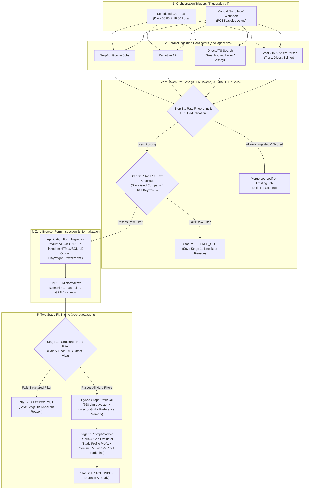

# Session 2 Detailed Design: Ingestion Connectors & Rubric Scoring Workflow (`packages/jobs` & `packages/agents`)

**Status:** Finalized & Approved (v2.0 — Cost-Funnel Ingestion, Zero-Browser Default Inspector, & Prompt-Cached Stage 2)  
**Parent Spec:** [spec.md](file:///Users/amirhf/job_assist/spec.md)  
**Prerequisite Design:** [session-1-database-and-career-graph.md](file:///Users/amirhf/job_assist/docs/design/session-1-database-and-career-graph.md)  
**Target Packages:** `packages/jobs` (Trigger.dev v4 tasks & connectors) and `packages/agents` (Mastra workflows, model router, & Stage 1/2 evaluators)

---

## 1. End-to-End Ingestion & Scoring Architecture (Cost-Funnel Order)

To minimize LLM token spend and worker memory in production, ingestion executes as a strict **Funnel of Increasing Cost**: raw deduplication and regex knockouts run *before* any form inspection or LLM normalization, and Stage 2 rubric evaluation uses **Static-Prefix Prompt Caching**.



---

## 2. Multi-Model Router Configuration (`packages/agents/src/routers/model-router.ts`)

To enforce the **Token-Efficient, On-Demand Generation** principle from [spec.md](file:///Users/amirhf/job_assist/spec.md#L34-L51), all agent calls route through a centralized tier configuration. Embeddings are locked at **768 dimensions** per Session 1.

```typescript
// packages/agents/src/routers/model-router.ts
import { EMBEDDING_DIMENSIONS } from '@job-copilot/db/schema/enums';

export type ModelTier =
  | 'TIER_1_INGESTION'
  | 'TIER_2_RUBRIC_DEFAULT'
  | 'TIER_2_RUBRIC_ESCALATED'
  | 'TIER_3_SYNTHESIS_DEFAULT'
  | 'TIER_3_SYNTHESIS_PREMIER';

export interface TierModelConfig {
  tier: ModelTier;
  primary: {
    provider: 'google' | 'openai' | 'anthropic';
    modelId: string;
    temperature: number;
    thinkingLevel?: 'minimal' | 'low' | 'medium' | 'high';
  };
  fallback: {
    provider: 'google' | 'openai' | 'anthropic';
    modelId: string;
    temperature: number;
  };
}

export const MODEL_ROUTING_TABLE: Record<ModelTier, TierModelConfig> = {
  TIER_1_INGESTION: {
    tier: 'TIER_1_INGESTION',
    primary: {
      provider: 'google',
      modelId: 'gemini-3.1-flash-lite',
      temperature: 0.0,
      thinkingLevel: 'minimal',
    },
    fallback: {
      provider: 'openai',
      modelId: 'gpt-5.4-nano',
      temperature: 0.0,
    },
  },
  TIER_2_RUBRIC_DEFAULT: {
    tier: 'TIER_2_RUBRIC_DEFAULT',
    primary: {
      provider: 'google',
      modelId: 'gemini-3.5-flash',
      temperature: 0.1,
      thinkingLevel: 'medium',
    },
    fallback: {
      provider: 'openai',
      modelId: 'gpt-5.4-mini',
      temperature: 0.1,
    },
  },
  TIER_2_RUBRIC_ESCALATED: {
    tier: 'TIER_2_RUBRIC_ESCALATED',
    primary: {
      provider: 'google',
      modelId: 'gemini-3.1-pro',
      temperature: 0.1,
      thinkingLevel: 'high',
    },
    fallback: {
      provider: 'openai',
      modelId: 'gpt-5.4',
      temperature: 0.1,
    },
  },
  TIER_3_SYNTHESIS_DEFAULT: {
    tier: 'TIER_3_SYNTHESIS_DEFAULT',
    primary: {
      provider: 'anthropic',
      modelId: 'claude-sonnet-4-6',
      temperature: 0.3,
    },
    fallback: {
      provider: 'openai',
      modelId: 'gpt-5.4',
      temperature: 0.3,
    },
  },
  TIER_3_SYNTHESIS_PREMIER: {
    tier: 'TIER_3_SYNTHESIS_PREMIER',
    primary: {
      provider: 'anthropic',
      modelId: 'claude-opus-4-6',
      temperature: 0.3,
    },
    fallback: {
      provider: 'anthropic',
      modelId: 'claude-sonnet-4-6',
      temperature: 0.3,
    },
  },
};

export const EMBEDDING_CONFIG = {
  provider: (process.env.EMBEDDING_PROVIDER ?? 'google') as 'google' | 'openai',
  modelId: process.env.EMBEDDING_MODEL_ID ?? 'gemini-embedding-001',
  dimensions: EMBEDDING_DIMENSIONS, // Locked at 768
} as const;
```

---

## 3. Ingestion Connector Interfaces & Implementations (`packages/jobs/src/connectors/`)

### 3.1 Unified Connector Contract (`types.ts`)

Every ingestion connector implements `JobIngestionConnector` and yields `RawDiscoveredJob` objects before they enter the Form Inspector and Tier 1 Normalizer.

```typescript
// packages/jobs/src/connectors/types.ts
import type { HardFiltersConfig } from '@job-copilot/db/schema/profile';
import type { ExtractedApplicationQuestion } from '@job-copilot/db/schema/jobs';

export type ConnectorId =
  | 'SERPAPI_GOOGLE_JOBS'
  | 'REMOTIVE'
  | 'ATS_DIRECT_SEARCH'
  | 'GMAIL_ALERT'
  | 'MANUAL_URL';

export interface ConnectorSearchContext {
  profileId: string;
  targetRoles: string[];
  hardFilters: HardFiltersConfig;
  sinceTimestamp: Date; // Incremental sync watermark
  maxResultsPerQuery?: number;
}

export interface RawDiscoveredJob {
  connector: ConnectorId;
  externalId?: string;
  sourceUrl: string;
  applicationUrl: string;
  companyNameRaw: string;
  titleRaw: string;
  locationRaw: string;
  salaryRaw?: string;
  descriptionHtmlOrText: string;
  postedAt?: Date;
  atsPlatformHint?: 'GREENHOUSE' | 'LEVER' | 'ASHBY' | 'WORKDAY' | 'CUSTOM';
  // Pre-extracted questions if the connector queried a native ATS JSON endpoint
  preExtractedQuestions?: ExtractedApplicationQuestion[];
}

export interface JobIngestionConnector {
  readonly id: ConnectorId;
  fetchJobs(ctx: ConnectorSearchContext): Promise<RawDiscoveredJob[]>;
}
```

### 3.2 Connector Specifications

#### A. SerpApi Google Jobs Connector (`serpapi-google-jobs.ts`)
- **Query Construction:** Builds cartesian queries from `ctx.targetRoles` (e.g., `"Staff Full-Stack Engineer"`, `"AI Systems Engineer"`) paired with location/remote modifiers derived from `ctx.hardFilters.allowedRemotePolicies` (`"Remote"` or allowed cities).
- **Parameters:** `engine=google_jobs`, `chips=date_posted:today` (for daily crons) or `date_posted:3days`, `hl=en`, `gl=us`.
- **Link Resolution:** Extracts `apply_options` from the SerpApi response, prioritizing direct ATS links (`greenhouse.io`, `lever.co`, `ashbyhq.com`, company career domains) over aggregator redirects (`linkedin.com`, `indeed.com`, `ziprecruiter.com`).

#### B. Remotive API Connector (`remotive.ts`)
- **Endpoint:** `GET https://remotive.com/api/remote-jobs?category=software-dev`
- **Filtering:** Filters response items in-memory where `new Date(job.publication_date) >= ctx.sinceTimestamp` and title/tags intersect with `ctx.targetRoles`.
- **Mapping:** Maps `company_name`, `title`, `candidate_required_location`, `salary`, `description` (HTML), and `url`.

#### C. Direct ATS Search & Native API Connector (`ats-search.ts`)
- **Discovery Query:** Uses SerpApi Google Search (`engine=google`, `tbs=qdr:d` for past 24h) with targeted dorks:
  ```text
  (site:boards.greenhouse.io OR site:job-boards.greenhouse.io OR site:jobs.lever.co OR site:jobs.ashbyhq.com) ("Senior" OR "Staff") ("TypeScript" OR "AI" OR "Full Stack")
  ```
- **Native ATS JSON Enrichment (Zero-Browser Fast Path):**
  Instead of launching headless Chromium for every standard ATS URL, the connector detects the ATS board token and Job ID from the URL and queries the public JSON API directly:
  1. **Greenhouse:** `GET https://boards-api.greenhouse.io/v1/boards/{board_token}/jobs/{job_id}?questions=true`
     - Directly returns `content` (HTML description), `location.name`, and the exact `questions` + `compliance` array (field labels, types `input_text` / `textarea` / `multi_value_single_select`, `required` boolean, and `values` options).
  2. **Lever:** `GET https://api.lever.co/v0/postings/{company}/{job_id}`
     - Returns `description`, `lists` (requirements), `categories.location`, `workplaceType`, and `salaryRange`.
  3. **Ashby:** `POST https://jobs.ashbyhq.com/api/non-user-graphql?op=ApiJobPosting`
     - Returns full job description HTML, compensation tier summary, and structured `applicationForm` field definitions.

#### D. Gmail / IMAP Alert Parser (`gmail-alerts.ts`)
- **Polling Mechanism:** Connects via Gmail REST API (OAuth2 refresh token) or `imapflow` (for local IMAP app passwords) and queries unread messages matching `label:JobCopilot/Alerts newer_than:2d`.
- **Digest Splitting via Tier 1 Model:** Alert emails from LinkedIn, Wellfound, or newsletter digests typically contain 5–25 job links in a single HTML email.
  1. Strips tracking pixels/styles and extracts all `<a href="...">` anchors with their surrounding text block.
  2. Calls `TIER_1_INGESTION` (`gemini-3.1-flash-lite`) with `EmailDigestExtractionSchema` to extract `{ companyName, jobTitle, locationHint, rawApplyUrl }[]`.
  3. Follows HTTP redirects (`HEAD`/`GET` with redirect tracking) on each `rawApplyUrl` to resolve the canonical destination URL and passes each resolved URL to the Application Form Inspector.
  4. Adds label `JobCopilot/Processed` and marks the email thread read.

---

## 4. Application Form Inspector & Tier 1 Normalizer (`packages/jobs/src/inspectors/`)

### 4.1 Zero-Browser Default Application Form Inspector (`form-inspector.ts`)
To keep production worker memory under `128 MB` (avoiding `1.2 GB` Chromium container bloat on Trigger.dev / Railway), form inspection uses a lightweight two-tier strategy:
1. **Default Path (Zero-Browser — Native ATS JSON + `linkedom` HTML/JSON-LD):**
   - For Greenhouse, Lever, Ashby, SmartRecruiters, and Workday URLs, queries the public JSON API directly (`preExtractedQuestions` from Section 3.2.C).
   - For custom portals, performs a standard `fetch()` and parses `<form>`, `<input>`, `<textarea>`, `<select>`, `__NEXT_DATA__`, and `application/ld+json` `JobPosting` blocks in-memory using `linkedom`.
2. **Opt-In Browser Fallback (`ENABLE_BROWSER_FORM_INSPECTOR=true`):**
   - Only when explicitly enabled via environment config for client-only SPA portals, connects to Browserbase or a local headless Playwright instance to reveal dynamic form controls, filtering out standard identity/EEO fields so only **custom screening questions** and **required attachment flags** are stored in `job_postings.extracted_questions`.

### 4.2 Tier 1 Job Normalization Schema (`packages/db/src/validators/job-normalization.ts`)

```typescript
// packages/db/src/validators/job-normalization.ts
import { z } from 'zod';

export const NormalizedJobPostingSchema = z.object({
  companyName: z.string(),
  title: z.string(),
  locationRaw: z.string(),
  locationBucket: z.string().describe(
    'Canonical bucket: "us-remote", "global-remote", "sf-bay-area", "nyc", "seattle", "austin", "london", or lowercase "<city>-<country>"'
  ),
  countryCode: z.string().length(2).default('US'),
  remotePolicy: z.enum([
    'REMOTE_GLOBAL',
    'REMOTE_COUNTRY_LOCKED',
    'REMOTE_TIMEZONE_LOCKED',
    'HYBRID',
    'ONSITE',
    'UNKNOWN',
  ]),
  allowedUtcOffsetRange: z.object({
    min: z.number().int().min(-12).max(14).optional(),
    max: z.number().int().min(-12).max(14).optional(),
  }).nullable().describe('Populated if posting specifies timezone bounds like "EST to PST" (-8 to -5)'),
  salaryMinUsd: z.number().int().nullable().describe('Annualized base salary floor in USD; convert hourly/monthly if needed, or null if unstated'),
  salaryMaxUsd: z.number().int().nullable().describe('Annualized base salary ceiling in USD, or null if unstated'),
  offersVisaSponsorship: z.boolean().nullable().describe(
    'false if posting explicitly states no sponsorship/citizenship required; true if sponsorship offered; null if unmentioned'
  ),
  cleanDescriptionMarkdown: z.string().describe('Clean Markdown of responsibilities, requirements, and company overview without boilerplate EEO footers'),
  extractedRequirements: z.object({
    mustHaveSkills: z.array(z.string()).describe('Explicitly required technical skills, languages, frameworks'),
    niceToHaveSkills: z.array(z.string()).describe('Preferred or bonus skills'),
    minYearsExperience: z.number().int().nullable(),
    seniorityLevel: z.enum(['JUNIOR', 'MID', 'SENIOR', 'STAFF_PRINCIPAL', 'LEAD_MANAGER', 'EXECUTIVE', 'UNKNOWN']),
    domainKeywords: z.array(z.string()),
  }),
  extractedQuestions: z.array(z.object({
    questionId: z.string(),
    label: z.string(),
    fieldType: z.enum(['SHORT_TEXT', 'LONG_TEXT', 'SINGLE_SELECT', 'MULTI_SELECT', 'BOOLEAN', 'NUMBER', 'FILE_UPLOAD', 'URL']),
    required: z.boolean(),
    options: z.array(z.string()).optional(),
    maxLength: z.number().int().optional(),
  })),
  requiredAttachments: z.object({
    resume: z.boolean().default(true),
    coverLetter: z.enum(['REQUIRED', 'OPTIONAL', 'NONE']).default('OPTIONAL'),
    portfolioUrl: z.boolean().default(false),
    otherFiles: z.array(z.string()).default([]),
  }),
  specialInstructions: z.array(z.object({
    instructionType: z.enum(['EASTER_EGG_PHRASE', 'COVER_LETTER_PROMPT', 'FORMATTING_RULE', 'SUBJECT_LINE']),
    exactRequirement: z.string(),
    sourceQuote: z.string().describe('Verbatim quote from the job posting containing the hidden/special instruction'),
  })).describe('Captures attention-check instructions such as "Include the word giraffe in your application"'),
});
```

---

## 5. Deterministic Deduplication Engine (`packages/jobs/src/dedup/deduplicator.ts`)

Duplicate postings frequently appear across Google Jobs, Remotive, LinkedIn alerts, and direct ATS boards.

### 5.1 Canonical Fingerprint Generation
```typescript
// packages/jobs/src/dedup/deduplicator.ts
import { createHash } from 'node:crypto';

export function normalizeCompanyName(raw: string): string {
  return raw
    .toLowerCase()
    .replace(/\b(inc\.?|llc\.?|ltd\.?|corp\.?|corporation|technologies|labs|ai|co\.?)\b/g, '')
    .replace(/[^a-z0-9]/g, '')
    .trim();
}

export function normalizeJobTitle(raw: string): string {
  return raw
    .toLowerCase()
    .replace(/\bsr\.?\b/g, 'senior')
    .replace(/\bjr\.?\b/g, 'junior')
    .replace(/\bswe\b/g, 'software engineer')
    .replace(/\bfull[- ]stack\b/g, 'fullstack')
    .replace(/\([^)]*\)/g, '') // Strip parenthetical team/req codes like "(Req #4921)"
    .replace(/[^a-z0-9\s]/g, ' ')
    .replace(/\s+/g, ' ')
    .trim();
}

export function computeDedupFingerprint(
  companyName: string,
  title: string,
  locationBucket: string
): {
  normalizedCompanyName: string;
  normalizedTitle: string;
  dedupFingerprint: string;
} {
  const normalizedCompanyName = normalizeCompanyName(companyName);
  const normalizedTitle = normalizeJobTitle(title);
  const normalizedBucket = locationBucket.toLowerCase().trim();

  const dedupFingerprint = createHash('sha256')
    .update(`${normalizedCompanyName}::${normalizedTitle}::${normalizedBucket}`)
    .digest('hex');

  return { normalizedCompanyName, normalizedTitle, dedupFingerprint };
}
```

### 5.2 Upsert & Source Merge Semantics
When inserting into `job_postings` on `dedup_fingerprint` conflict:
- **Append `sources`**: Merges the new `JobPostingSourceEntry` into `job_postings.sources` (deduplicated by `sourceUrl`).
- **Prefer Direct ATS Application URL**: If the existing record has an aggregator URL and the incoming record has a direct ATS URL (`GREENHOUSE`, `LEVER`, `ASHBY`), upgrades `application_url` and `extracted_questions`.
- **Preserve Pipeline State**: Never overwrites `status` if the existing record has already progressed past `INGESTED` (e.g., `TRIAGE_INBOX`, `REJECTED`, `APPROVED`, `READY_TO_APPLY`, `APPLIED`).

---

## 6. Two-Stage Fit Engine (`packages/agents/src/workflows/ingest-and-score.ts`)

### 6.1 Stage 1: Zero-Token Deterministic Gate (`stage1-filter.ts`)

Stage 1 executes in `< 1ms` in pure TypeScript with **zero LLM tokens**, evaluating the normalized job against `candidateProfile.hardFilters`.

```typescript
// packages/agents/src/evaluators/stage1-filter.ts
import type { HardFiltersConfig } from '@job-copilot/db/schema/profile';
import type { InferSelectModel } from 'drizzle-orm';
import type { jobPostings } from '@job-copilot/db/schema/jobs';

export interface Stage1KnockoutReason {
  rule:
    | 'BLACKLISTED_COMPANY'
    | 'BLACKLISTED_TITLE_KEYWORD'
    | 'BLACKLISTED_DESCRIPTION_KEYWORD'
    | 'REMOTE_POLICY_MISMATCH'
    | 'COUNTRY_NOT_ALLOWED'
    | 'LOCATION_NOT_ALLOWED'
    | 'TIMEZONE_OUTSIDE_BOUNDS'
    | 'SALARY_BELOW_FLOOR'
    | 'VISA_SPONSORSHIP_UNAVAILABLE';
  expected: string;
  actual: string;
}

export function evaluateStage1HardFilters(
  job: InferSelectModel<typeof jobPostings>,
  filters: HardFiltersConfig
): { passed: boolean; knockoutReasons: Stage1KnockoutReason[] } {
  const reasons: Stage1KnockoutReason[] = [];

  // 1. Blacklisted Company
  const normalizedBlacklisted = filters.blacklistedCompanies.map((c) =>
    c.toLowerCase().replace(/[^a-z0-9]/g, '')
  );
  if (normalizedBlacklisted.includes(job.normalizedCompanyName)) {
    reasons.push({
      rule: 'BLACKLISTED_COMPANY',
      expected: 'Not in company blocklist',
      actual: job.companyName,
    });
  }

  // 2. Blacklisted Title Keywords
  const lowerTitle = job.title.toLowerCase();
  for (const kw of filters.blacklistedTitleKeywords) {
    if (lowerTitle.includes(kw.toLowerCase())) {
      reasons.push({
        rule: 'BLACKLISTED_TITLE_KEYWORD',
        expected: `Title must not contain "${kw}"`,
        actual: job.title,
      });
    }
  }

  // 3. Blacklisted Description Keywords
  const lowerDesc = job.cleanDescriptionMarkdown.toLowerCase();
  for (const kw of filters.blacklistedDescriptionKeywords) {
    if (lowerDesc.includes(kw.toLowerCase())) {
      reasons.push({
        rule: 'BLACKLISTED_DESCRIPTION_KEYWORD',
        expected: `Description must not contain "${kw}"`,
        actual: `Matched keyword "${kw}"`,
      });
    }
  }

  // 4. Remote Policy & Location Check
  if (
    job.remotePolicy !== 'UNKNOWN' &&
    !filters.allowedRemotePolicies.includes(job.remotePolicy)
  ) {
    reasons.push({
      rule: 'REMOTE_POLICY_MISMATCH',
      expected: filters.allowedRemotePolicies.join(' | '),
      actual: job.remotePolicy,
    });
  }

  if (
    job.countryCode &&
    filters.allowedCountries.length > 0 &&
    job.remotePolicy !== 'REMOTE_GLOBAL' &&
    !filters.allowedCountries.includes(job.countryCode)
  ) {
    reasons.push({
      rule: 'COUNTRY_NOT_ALLOWED',
      expected: filters.allowedCountries.join(', '),
      actual: job.countryCode,
    });
  }

  // 5. Timezone Overlap Check
  if (job.allowedUtcOffsetRange?.min !== undefined && job.allowedUtcOffsetRange?.max !== undefined) {
    const overlaps =
      Math.max(job.allowedUtcOffsetRange.min, filters.allowedUtcOffsetRange.min) <=
      Math.min(job.allowedUtcOffsetRange.max, filters.allowedUtcOffsetRange.max);
    if (!overlaps) {
      reasons.push({
        rule: 'TIMEZONE_OUTSIDE_BOUNDS',
        expected: `UTC ${filters.allowedUtcOffsetRange.min} to ${filters.allowedUtcOffsetRange.max}`,
        actual: `UTC ${job.allowedUtcOffsetRange.min} to ${job.allowedUtcOffsetRange.max}`,
      });
    }
  }

  // 6. Minimum Base Salary Floor
  if (filters.minBaseSalaryUsd !== null) {
    const statedCeiling = job.salaryMaxUsd ?? job.salaryMinUsd;
    if (statedCeiling === null) {
      if (!filters.allowUnlistedSalary) {
        reasons.push({
          rule: 'SALARY_BELOW_FLOOR',
          expected: `>= $${filters.minBaseSalaryUsd.toLocaleString()} (unlisted not allowed)`,
          actual: 'Salary unlisted',
        });
      }
    } else if (statedCeiling < filters.minBaseSalaryUsd) {
      reasons.push({
        rule: 'SALARY_BELOW_FLOOR',
        expected: `>= $${filters.minBaseSalaryUsd.toLocaleString()}`,
        actual: `Max stated: $${statedCeiling.toLocaleString()}`,
      });
    }
  }

  // 7. Visa Sponsorship Requirement
  if (filters.requiresVisaSponsorship && job.offersVisaSponsorship === false) {
    reasons.push({
      rule: 'VISA_SPONSORSHIP_UNAVAILABLE',
      expected: 'Visa sponsorship available',
      actual: 'Posting explicitly states no visa sponsorship',
    });
  }

  return {
    passed: reasons.length === 0,
    knockoutReasons: reasons,
  };
}
```

---

### 6.2 Stage 2: Mastra Weighted Rubric Evaluator & Gap Detector

#### A. Stage 2 Structured Output Schema (`packages/db/src/validators/fit-evaluation.ts`)

```typescript
// packages/db/src/validators/fit-evaluation.ts
import { z } from 'zod';

export const CategoryScoreDetailSchema = z.object({
  score: z.number().int().min(0).max(100),
  rationale: z.string().describe('Concise evidence-backed justification citing specific Career Block IDs or missing requirements'),
});

export const Stage2RubricOutputSchema = z.object({
  categoryScores: z.object({
    techStackAlignment: CategoryScoreDetailSchema,
    seniorityAndScope: CategoryScoreDetailSchema,
    domainIndustryFit: CategoryScoreDetailSchema,
    companyStageCulture: CategoryScoreDetailSchema,
  }),
  preferencePenaltyPoints: z.number().int().min(-30).max(15).default(0).describe(
    'Score adjustment (-30 to +15) based on learned preference_memory rules (e.g. negative penalty if role matches past user rejection patterns)'
  ),
  executiveSummary: z.string().describe(
    '3-4 crisp Markdown bullet points highlighting the strongest fit signals and any notable trade-offs for Surface A Triage Inbox'
  ),
  topMatchedBlockIds: z.object({
    experienceIds: z.array(z.string()),
    bulletIds: z.array(z.string()),
    projectIds: z.array(z.string()),
    skillIds: z.array(z.string()),
  }),
  flaggedGaps: z.array(z.object({
    gapId: z.string().describe('Deterministic slug, e.g. "gap-kubernetes-production"'),
    requirementText: z.string().describe('Verbatim requirement from the job posting'),
    missingSkillName: z.string().describe('Specific skill, domain, or credential absent from the Master Career Graph'),
    severity: z.enum(['CRITICAL', 'MODERATE', 'MINOR']),
    adjacentVerifiedSkills: z.array(z.object({
      skillId: z.string().describe('ID of a verified skill in career_skills'),
      skillName: z.string(),
      rationale: z.string().describe('How this verified skill transfers or bridges the missing requirement'),
    })),
  })),
});

export type Stage2RubricOutput = z.infer<typeof Stage2RubricOutputSchema>;
```

#### B. Deterministic Overall Score Computation
Rather than relying on the LLM to do weighted arithmetic, TypeScript computes `overallScore` deterministically from the user's `RubricWeightsConfig` sliders ($w_1, w_2, w_3, w_4$):

$$\text{OverallScore} = \text{clamp}_{[0, 100]}\left(\text{round}\left(\frac{\sum_{i \in \{ \text{tech}, \text{seniority}, \text{domain}, \text{culture} \}} w_i \cdot S_i}{\sum w_i}\right) + \text{preferencePenaltyPoints}\right)$$

#### C. Stage 2 Rubric Scoring System Prompt (`packages/agents/src/prompts/rubric-scoring.ts`)

```markdown
You are the **Calibration & Fit Assessment Engine** for the Agentic Job Application Copilot.
Evaluate the target `JobPosting` against the candidate's verified `MasterCareerGraph` retrieved via hybrid search and their learned `PreferenceMemory`.

### SCORING CALIBRATION & ZERO-HALLUCINATION RULES
1. **Strict Evidence Grounding:**
   - Only credit a technical skill, leadership scope, or domain achievement if it appears in the provided `verifiedSkills`, `matchedExperiences`, `matchedBullets`, or `matchedProjects`.
   - Every ID placed in `topMatchedBlockIds` MUST exist in the retrieved context.
2. **Category Scoring Anchors (0–100):**
   - `90–100`: Near-perfect alignment; candidate has shipped production systems with the exact core stack, seniority scope, and domain.
   - `75–89`: Strong fit; candidate meets >= 80% of core requirements and has clear adjacent skills for minor gaps.
   - `55–74`: Partial/stretch fit; candidate is missing 1–2 notable requirements or is transitioning across domains/seniority.
   - `0–54`: Weak fit; core technical stack or seniority scope diverges substantially.
3. **Gap Severity Classification (`flaggedGaps`):**
   - `CRITICAL`: A hard "Must-Have" requirement central to the role (e.g., "5+ years production Rust" or "Experience with FDA Class II medical device submissions") that has ZERO direct evidence in the Master Career Graph. Flagging a `CRITICAL` gap will pause downstream material generation (`PAUSED_NEEDS_INPUT`) to ask the candidate if they have unrecorded experience.
   - `MODERATE`: An important requirement missing direct evidence, but bridgeable via one of the candidate's `adjacentVerifiedSkills` (e.g., job asks for `GCP Cloud Run`, candidate has verified production `AWS ECS/Fargate` & `Kubernetes`).
   - `MINOR`: A "Nice-to-Have" tool or secondary library that does not block candidacy.
4. **Preference Memory Enforcement:**
   - Review the provided `learnedRejectionRules` from `preference_memory`. If the job exhibits patterns the user has repeatedly rejected (e.g., heavy on-call maintenance, specific sub-industries), apply an appropriate negative `preferencePenaltyPoints` (-5 to -30) and note it in `executiveSummary`.
```

#### D. Mastra `ingestAndScoreWorkflow` Definition (`packages/agents/src/workflows/ingest-and-score.ts`)
1. **`embedAndPersistJobStep`**: Generates the 768-dim vector embedding for `cleanDescriptionMarkdown + extractedRequirements` using `EMBEDDING_CONFIG`.
2. **`runStage1FilterStep`**: Runs `evaluateStage1HardFilters(job, profile.hardFilters)`. If `passed === false`, inserts a `fit_evaluations` row with `stage1Passed: false` and updates `job_postings.status = 'FILTERED_OUT'`, terminating early with zero LLM scoring cost.
3. **`retrieveHybridContextStep`**:
   - Calls `hybridSearchCareerBullets()` (top 25 bullets), `hybridSearchCareerProjects()` (top 8 projects), fetches all `careerExperiences` and verified `careerSkills` (with `careerSkillEvidence` counts), and retrieves top 10 active `preferenceMemory` rows matching `JOB_REJECTION_PATTERN` or `RUBRIC_CALIBRATION`.
4. **`scoreRubricStep` (with Static-Prefix Prompt Caching)**:
   - Places the **System Instructions + Candidate Executive Summary + All Verified Career Skills + Active Preference Memory Rules** in the static cached prefix of the prompt, appending the job posting and job-specific RRF-retrieved bullets at the end. Across a batch of 20+ jobs, this achieves a **75%–90% input token cache hit rate**.
   - Invokes `TIER_2_RUBRIC_DEFAULT` (`gemini-3.5-flash`).
   - **Borderline Escalation Check**: If the computed `overallScore` falls between `68` and `78` AND `flaggedGaps` contains a `CRITICAL` gap, re-evaluates with `TIER_2_RUBRIC_ESCALATED` (`gemini-3.1-pro`, `thinkingLevel: 'high'`) for high-precision gap adjudication.
   - Saves the record to `fit_evaluations` and transitions `job_postings.status = 'TRIAGE_INBOX'`.

---

## 7. Trigger.dev v4 Tasks & Cron Schedules (`packages/jobs/src/trigger/`)

```typescript
// packages/jobs/src/trigger/ingest-jobs.ts
import { schedules, task, batch } from '@trigger.dev/sdk/v3';
import { db } from '@job-copilot/db';
import { runAllConnectors } from '../connectors/runner';
import { inspectAndNormalizeJob } from '../inspectors/pipeline';
import { upsertDeduplicatedJob } from '../dedup/deduplicator';
import { ingestAndScoreWorkflow } from '@job-copilot/agents/workflows/ingest-and-score';

// 1. Child Task: Score a single normalized job posting with concurrency control
export const scoreSingleJobTask = task({
  id: 'score-single-job',
  queue: {
    name: 'rubric-scoring-queue',
    concurrencyLimit: 5, // Respect LLM rate limits while parallelizing
  },
  retry: {
    maxAttempts: 3,
    factor: 2,
    minTimeoutInMs: 2000,
  },
  run: async (payload: { jobPostingId: string; profileId: string }) => {
    return await ingestAndScoreWorkflow.execute(payload);
  },
});

// 2. Orchestrator Task: Manual or Scheduled Full Sync
export const syncAllJobSourcesTask = task({
  id: 'sync-all-job-sources',
  run: async (payload: { profileId: string; connectors?: string[]; sinceHours?: number }) => {
    const rawJobs = await runAllConnectors(payload);
    const newlyIngestedJobIds: string[] = [];

    for (const rawJob of rawJobs) {
      // Step 1: Zero-token raw dedup check before any HTTP form inspection or LLM call
      const existingCheck = await checkOrMergeRawDuplicate(rawJob);
      if (existingCheck.alreadyScored) continue;

      // Step 2: Zero-token Stage 1a raw regex pre-filter (company & title blocklists)
      const stage1a = evaluateStage1aRawPreFilter(rawJob, hardFilters);
      if (!stage1a.passed) {
        await persistRawFilteredOutJob(rawJob, stage1a.knockoutReasons);
        continue;
      }

      // Step 3: Lightweight Form Inspection + Tier 1 LLM Normalization
      const normalized = await inspectAndNormalizeJob(rawJob);
      const { jobId, shouldScore } = await upsertDeduplicatedJob(normalized);
      if (shouldScore) {
        newlyIngestedJobIds.push(jobId);
      }
    }

    if (newlyIngestedJobIds.length > 0) {
      await batch.triggerByTask(
        newlyIngestedJobIds.map((jobPostingId) => ({
          task: scoreSingleJobTask,
          payload: { jobPostingId, profileId: payload.profileId },
        }))
      );
    }

    return {
      discoveredCount: rawJobs.length,
      queuedForScoringCount: newlyIngestedJobIds.length,
    };
  },
});

// 3. Scheduled Cron: Runs twice daily at 06:00 and 18:00 America/Los_Angeles
export const dailyJobIngestionSchedule = schedules.task({
  id: 'daily-job-ingestion-schedule',
  cron: {
    pattern: '0 6,18 * * *',
    timezone: 'America/Los_Angeles',
  },
  run: async () => {
    const defaultProfile = await db.query.candidateProfile.findFirst();
    if (!defaultProfile) return { skipped: true, reason: 'No candidate profile configured' };

    return await syncAllJobSourcesTask.triggerAndWait({
      profileId: defaultProfile.id,
      sinceHours: 14,
    });
  },
});
```

### Manual Trigger Webhook (`apps/web/app/api/jobs/sync/route.ts`)
- Invoked by the **"Sync Now"** button in Surface A (`Triage Inbox`).
- Triggers `syncAllJobSourcesTask.trigger({ profileId, connectors })` and returns `{ runId, publicAccessToken }` so the Next.js UI can display a live sync progress badge via `@trigger.dev/react-hooks`.
