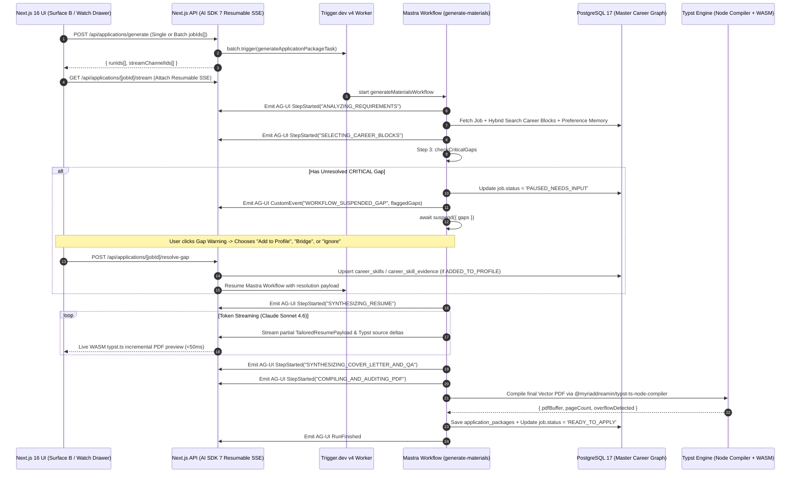

# Session 3 Detailed Design: Watchable Async Generation & Typst PDF Pipeline (`packages/agents` & `packages/pdf-engine`)

**Status:** Finalized & Approved (v2.0 — Trigger.dev Realtime + Pooled SQL Replay & Stateless PDF Storage)  
**Parent Spec:** [spec.md](file:///Users/amirhf/job_assist/spec.md)  
**Prerequisite Designs:** [session-1-database-and-career-graph.md](file:///Users/amirhf/job_assist/docs/design/session-1-database-and-career-graph.md), [session-2-ingestion-and-rubric-scoring.md](file:///Users/amirhf/job_assist/docs/design/session-2-ingestion-and-rubric-scoring.md)  
**Target Packages:** `packages/agents` (`generate-materials` workflow), `packages/pdf-engine` (Typst templates & Node/WASM compilers), `packages/jobs` (async batch worker), and `apps/web/app/api/stream` (Vercel AI SDK 7 + AG-UI 1.0 resumable SSE)

---

## 1. End-to-End Watchable Generation & Suspension Architecture



---

## 2. Mastra 6-Step `generate-materials` Workflow (`packages/agents/src/workflows/generate-materials.ts`)

### 2.1 Workflow State & Step Contracts

The Mastra workflow orchestrates 6 deterministic/agentic steps and supports durable `.suspend()` and `.resume()` when a `CRITICAL` skill gap requires candidate input.

```typescript
// packages/agents/src/workflows/generate-materials.ts
import { createWorkflow, createStep } from '@mastra/core/workflows';
import { z } from 'zod';
import { db } from '@job-copilot/db';
import { publishAgUiEvent } from '../streaming/ag-ui-publisher';
import { compileAndAuditResumePdf, compileCoverLetterPdf } from '@job-copilot/pdf-engine';

export const GenerateMaterialsInputSchema = z.object({
  jobPostingId: z.string().uuid(),
  profileId: z.string().uuid(),
  packageId: z.string().uuid(),
  streamChannelId: z.string(),
  synthesisModelTier: z
    .enum(['TIER_3_SYNTHESIS_DEFAULT', 'TIER_3_SYNTHESIS_PREMIER'])
    .default('TIER_3_SYNTHESIS_DEFAULT'),
});

export const GapResolutionResumeSchema = z.object({
  resolutions: z.array(z.object({
    gapId: z.string(),
    action: z.enum(['ADDED_TO_PROFILE', 'BRIDGED', 'IGNORED']),
    newSkillId: z.string().optional(),
    newBulletId: z.string().optional(),
    bridgeSkillId: z.string().optional(),
    userGuidanceNote: z.string().optional(),
  })),
});

// Step 1: analyzeRequirements
export const analyzeRequirementsStep = createStep({
  id: 'analyzeRequirements',
  description: 'Extracts mandatory ATS keywords, seniority tone, and special instructions',
  execute: async ({ context, writer }) => {
    const { jobPostingId, streamChannelId } = context.inputData;
    await publishAgUiEvent(streamChannelId, {
      type: 'STEP_STARTED',
      step: 'ANALYZING_REQUIREMENTS',
      message: 'Analyzing ATS target keywords, role priorities, and special posting instructions...',
    });

    const job = await db.query.jobPostings.findFirst({
      where: (jp, { eq }) => eq(jp.id, jobPostingId),
      with: { fitEvaluation: true },
    });
    if (!job) throw new Error(`Job posting ${jobPostingId} not found`);

    // Extracts prioritized keyword checklist & tone profile using Tier 2 model
    const targetBlueprint = await extractTargetRoleBlueprint(job);
    return { job, targetBlueprint };
  },
});

// Step 2: selectCareerBlocks
export const selectCareerBlocksStep = createStep({
  id: 'selectCareerBlocks',
  description: 'Ranks experiences, atomic bullets, projects, and STAR stories via hybrid RRF search',
  execute: async ({ context }) => {
    const { profileId, streamChannelId } = context.inputData;
    const { job, targetBlueprint } = context.getStepResult(analyzeRequirementsStep);

    await publishAgUiEvent(streamChannelId, {
      type: 'STEP_STARTED',
      step: 'SELECTING_CAREER_BLOCKS',
      message: 'Querying Master Career Graph via hybrid search (768-dim pgvector + BM25)...',
    });

    // Selects all experiences, top 4-6 bullets per experience ranked by RRF against targetBlueprint,
    // top 2-3 projects, relevant STAR stories for screening questions, and active preference_memory rules
    const selectedGraph = await selectOptimalCareerBlocks({
      profileId,
      job,
      targetBlueprint,
    });

    await publishAgUiEvent(streamChannelId, {
      type: 'STATE_SNAPSHOT',
      step: 'SELECTING_CAREER_BLOCKS',
      payload: {
        selectedExperienceCount: selectedGraph.experiences.length,
        selectedBulletCount: selectedGraph.bullets.length,
        selectedProjectCount: selectedGraph.projects.length,
      },
    });

    return { selectedGraph };
  },
});

// Step 3: checkCriticalGaps (Human-in-the-Loop .suspend() / .resume() Gate)
export const checkCriticalGapsStep = createStep({
  id: 'checkCriticalGaps',
  description: 'Suspends workflow if unresolved CRITICAL gaps exist in fit_evaluations',
  resumeSchema: GapResolutionResumeSchema,
  execute: async ({ context, suspend, resumeData }) => {
    const { jobPostingId, profileId, streamChannelId } = context.inputData;
    const { job } = context.getStepResult(analyzeRequirementsStep);

    const unresolvedCriticalGaps = (job.fitEvaluation?.flaggedGaps ?? []).filter(
      (g) => g.severity === 'CRITICAL' && g.resolutionStatus === 'OPEN'
    );

    // If there are unresolved critical gaps and we haven't resumed with user input yet, suspend!
    if (unresolvedCriticalGaps.length > 0 && !resumeData) {
      await db.updateJobStatus(jobPostingId, 'PAUSED_NEEDS_INPUT');
      await publishAgUiEvent(streamChannelId, {
        type: 'CUSTOM',
        name: 'WORKFLOW_SUSPENDED_ON_GAP',
        value: {
          jobPostingId,
          unresolvedCriticalGaps,
        },
      });

      await suspend({
        reason: 'UNRESOLVED_CRITICAL_GAPS',
        unresolvedCriticalGaps,
      });
    }

    // When resumed (or if no critical gaps existed), reload any newly added profile evidence
    const updatedBridgingDirectives = await applyGapResolutions({
      jobPostingId,
      profileId,
      resolutions: resumeData?.resolutions ?? [],
    });

    return { updatedBridgingDirectives };
  },
});
```

### 2.2 Steps 4–6: Persuasive Synthesis & PDF Compilation Audit

- **Step 4: `synthesizeResumeStep` (Claude Sonnet 4.6 / Optional Opus 4.6)**
  - Consumes `selectedGraph` (verified experiences, atomic bullets with exact `quantifiedMetrics`, verified `careerSkills` + `careerSkillEvidence`), `updatedBridgingDirectives`, and active `preferenceMemory` rules (`PHRASING_REPLACEMENT`, `TONE_AND_STYLE_RULE`).
  - Streams structured tokens while compiling intermediate Typst source (`renderResumeTypstSource(partialResumeData)`) and pushing `TYPST_SOURCE_DELTA` events over the SSE channel so the user sees the resume PDF updating live in the Watch Drawer.
  - **Hard Truthfulness Guardrail:** Every tailored bullet in `TailoredResumePayload` must include `sourceBulletId` pointing to an existing `career_bullets.id`. A post-generation validator verifies that no numeric metric appears in `tailoredText` unless it exists in the source bullet's `quantifiedMetrics` or `bulletText`.
- **Step 5: `synthesizeCoverLetterAndQAStep` (Claude Sonnet 4.6)**
  - Drafts a concise 3–4 paragraph cover letter grounded in top matched experiences/projects and explicitly satisfies any `specialInstructions` (e.g., `EASTER_EGG_PHRASE` or `COVER_LETTER_PROMPT` extracted during Session 2).
  - Iterates over `job.extractedQuestions`, retrieving the highest-scoring `careerStories` (STAR narratives) and drafting tailored answers that respect `maxLength` character/word limits.
- **Step 6: `compileAndAuditPdfStep` (`@myriaddreamin/typst-ts-node-compiler` + Stateless Storage)**
  - Compiles both `resumeTypstSource` and `coverLetterTypstSource` to vector PDF buffers in memory (`~25–45 KB`).
  - **Automated Page-Count & Overflow Self-Correction:**
    - Inspects the compiled PDF metadata (`pageCount`). If `pageCount > targetMaxPages` (e.g., spills onto page 2 by 4 lines when a 1-page target is set), automatically triggers a fast tightening pass (adjusting Typst layout spacing parameter `density: "compact"` or trimming the lowest-ranked bullet on the oldest experience) and recompiles.
  - **Stateless Persistence (`StorageProvider`):**
    - Persists the compiled PDF buffers via `storageProvider` (`postgres` base64 column on `application_packages` by default, or Cloudflare R2 object keys when `STORAGE_PROVIDER=r2`) so Next.js and Trigger.dev workers require zero shared filesystem volumes.
  - Computes `PdfCompilationAudit` (`atsKeywordCoveragePercent`, `specialInstructionsVerified`, `zeroHallucinationAuditPassed`) and updates `job_postings.status = 'READY_TO_APPLY'`.

---

## 3. Watchable Streaming Protocol: Trigger.dev Realtime + Pooled SQL Replay + AG-UI 1.0

### 3.1 Serverless-Friendly Resumable Stream Architecture (`packages/agents/src/streaming/`)
Users can trigger generation on 1 or 10 approved jobs simultaneously, close their browser tab, or switch between jobs in the **Approved & Generating** queue without losing stream state—and without holding open stateful PostgreSQL `LISTEN/NOTIFY` TCP connections that would block serverless databases (Neon/Supabase) from scaling to zero.

1. **Event Push + Pooled SQL History Buffer (`Trigger.dev Realtime` + `generation_stream_events` table):**
   - Every event emitted by `publishAgUiEvent(streamChannelId, event)` is written via a standard pooled SQL insert to `generation_stream_events` with a monotonic `seq` integer and pushed over **Trigger.dev v4 Realtime (`streams` / `useRealtimeRun`)**.
   - When a client connects or reconnects to `/api/applications/[jobId]/stream?lastEventSeq=N`, the endpoint executes a short pooled query (`SELECT * FROM generation_stream_events WHERE stream_channel_id = $1 AND seq > $2 ORDER BY seq ASC`) to replay missed steps/snapshots, eliminating both Redis and stateful `LISTEN/NOTIFY` connections.
2. **AG-UI 1.0 Event Schema (`@ag-ui/core` compatible):**
   ```typescript
   export type WatchableGenerationEvent =
     | { seq: number; type: 'STEP_STARTED'; step: GenerationStep; message: string; timestamp: string }
     | { seq: number; type: 'REASONING_DELTA'; delta: string; step: GenerationStep }
     | { seq: number; type: 'TYPST_SOURCE_UPDATED'; documentType: 'RESUME' | 'COVER_LETTER'; typstSource: string }
     | { seq: number; type: 'QA_DRAFTED'; questionId: string; draftedAnswer: string }
     | { seq: number; type: 'WORKFLOW_SUSPENDED_ON_GAP'; unresolvedCriticalGaps: FlaggedSkillGap[] }
     | { seq: number; type: 'AUDIT_COMPLETED'; audit: PdfCompilationAudit }
     | { seq: number; type: 'RUN_FINISHED'; packageId: string; status: 'READY_TO_APPLY' | 'FAILED' };
   ```
3. **Resumable SSE Endpoint (`apps/web/app/api/applications/[jobId]/stream/route.ts`):**
   - Accepts `?lastEventSeq=N` (or standard SSE `Last-Event-ID` header).
   - Immediately replays all buffered events with `seq > N` (including the latest `TYPST_SOURCE_UPDATED` snapshot so the WASM preview renders immediately upon drawer open) and then streams live incremental events until `RUN_FINISHED` or `WORKFLOW_SUSPENDED_ON_GAP`.

---

## 4. Typst PDF Compilation Engine (`packages/pdf-engine/`)

### 4.1 Package Structure
```text
packages/pdf-engine/
├── templates/
│   ├── resume-modern-ats.typ       # Clean, single-column ATS-parsable vector template
│   ├── cover-letter-modern.typ     # Matching typographic header & layout
│   └── fonts/                      # Bundled Inter / Source Sans 3 / JetBrains Mono
├── src/
│   ├── generator.ts                # Serializes TailoredResumePayload -> valid Typst markup
│   ├── node-compiler.ts            # Server-side @myriaddreamin/typst-ts-node-compiler wrapper
│   ├── wasm-renderer.ts            # Browser-side @myriaddreamin/typst.ts incremental SVG/PDF preview
│   └── auditor.ts                  # Verifies page count, keyword coverage, and metric fidelity
└── package.json
```

### 4.2 Modular ATS-Safe Typst Resume Template (`templates/resume-modern-ats.typ`)

The template accepts a structured JSON/dict parameter (`data`) and a `density` layout knob (`"comfortable"` | `"standard"` | `"compact"`) so the compiler can deterministically fit 1-page or 2-page targets without LLM trial-and-error on CSS/margins.

```typst
// packages/pdf-engine/templates/resume-modern-ats.typ
#let render-resume(data, density: "standard") = {
  let margin-y = if density == "compact" { 0.42in } else if density == "comfortable" { 0.6in } else { 0.5in }
  let margin-x = if density == "compact" { 0.48in } else { 0.55in }
  let body-size = if density == "compact" { 9.2pt } else { 9.6pt }
  let block-spacing = if density == "compact" { 5pt } else { 7pt }

  set page(
    paper: "us-letter",
    margin: (x: margin-x, y: margin-y),
  )
  set text(
    font: ("Inter", "Liberation Sans"),
    size: body-size,
    fill: rgb("#111827"),
  )
  set par(justify: false, leading: 0.52em)

  // 1. Candidate Header (ATS Linear Text Flow)
  align(center)[
    #text(size: 16pt, weight: "bold")[#data.candidate.fullName] \
    #v(2pt)
    #text(size: 10pt, weight: "medium", fill: rgb("#374151"))[#data.targetHeadline] \
    #v(2pt)
    #text(size: 8.8pt, fill: rgb("#4B5563"))[
      #data.candidate.locationCity | #data.candidate.email
      #if data.candidate.phone != none [ | #data.candidate.phone ]
      #if data.candidate.linkedinUrl != none [ | #link(data.candidate.linkedinUrl)[LinkedIn] ]
      #if data.candidate.githubUrl != none [ | #link(data.candidate.githubUrl)[GitHub] ]
      #if data.candidate.portfolioUrl != none [ | #link(data.candidate.portfolioUrl)[Portfolio] ]
    ]
  ]

  v(block-spacing)
  line(length: 100%, stroke: 0.6pt + rgb("#D1D5DB"))

  // 2. Executive Summary
  if data.executiveSummary != "" {
    text(size: 10pt, weight: "bold", tracking: 0.04em)[SUMMARY]
    v(3pt)
    [#data.executiveSummary]
    v(block-spacing)
  }

  // 3. Technical Skills
  text(size: 10pt, weight: "bold", tracking: 0.04em)[TECHNICAL SKILLS]
  v(3pt)
  for group in data.categorizedSkills [
    *#group.categoryLabel:* #group.skills.join(", ") \
  ]
  v(block-spacing)

  // 4. Professional Experience
  text(size: 10pt, weight: "bold", tracking: 0.04em)[EXPERIENCE]
  v(3pt)
  for exp in data.selectedExperiences [
    #grid(
      columns: (1fr, auto),
      [*#exp.jobTitle* — #exp.companyName (#exp.locationText)],
      [#text(style: "italic", fill: rgb("#4B5563"))[#exp.dateRangeText]]
    )
    #v(2pt)
    #for b in exp.tailoredBullets [
      - #b.tailoredText
    ]
    #v(block-spacing)
  ]

  // 5. Selected Engineering Projects
  if data.selectedProjects.len() > 0 {
    text(size: 10pt, weight: "bold", tracking: 0.04em)[SELECTED PROJECTS]
    v(3pt)
    for proj in data.selectedProjects [
      *#proj.projectName* — #proj.tailoredSummary \
      #for hl in proj.tailoredHighlights [
        - #hl
      ]
      #v(block-spacing)
    ]
  }
}
```

### 4.3 Dual Compilation Pipeline (Server Node Compiler + Browser WASM)

```typescript
// packages/pdf-engine/src/node-compiler.ts
import { NodeCompiler } from '@myriaddreamin/typst-ts-node-compiler';
import path from 'node:path';

const compiler = NodeCompiler.create({
  workspace: path.resolve(__dirname, '../templates'),
  fontArgs: [{ fontPaths: [path.resolve(__dirname, '../templates/fonts')] }],
});

export interface CompiledPdfResult {
  pdfBuffer: Buffer;
  svgPages: string[];
  pageCount: number;
}

export function compileTypstToPdf(mainFileContent: string): CompiledPdfResult {
  const doc = compiler.compile({ mainFileContent });
  if (!doc.result) {
    throw new Error(`Typst compilation failed: ${JSON.stringify(doc.takeDiagnostics())}`);
  }
  const pdfBuffer = compiler.pdf(doc.result);
  const svgPages = compiler.svg(doc.result).split('<!-- PAGE_BREAK -->');
  return {
    pdfBuffer,
    svgPages,
    pageCount: svgPages.length,
  };
}
```

- **Browser Studio Instant Preview (`wasm-renderer.ts`):**
  - Uses `@myriaddreamin/typst.ts` initialized with a Web Worker and preloaded font assets in `apps/web/public/wasm/`.
  - Whenever the user edits Markdown/structured fields in the Studio (`Surface C`) or receives a `TYPST_SOURCE_UPDATED` event in the Watchable Live Drawer (`Surface B`), the browser compiles the updated `.typ` string to crisp vector SVG/Canvas in **15–35ms** with zero server round-trip.
