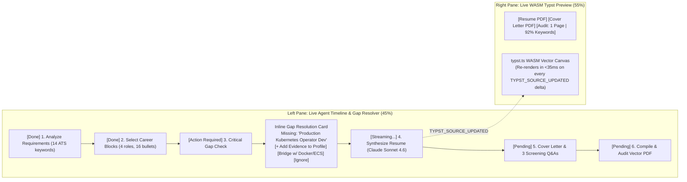

# Session 4 Detailed Design: Next.js 16 Pipeline Surfaces & Interactive Studio (`apps/web`)

**Status:** Finalized & Approved (v2.0 — Stateless Cloud UI + 3-Mode Assisted Apply Launcher)  
**Parent Spec:** [spec.md](file:///Users/amirhf/job_assist/spec.md)  
**Prerequisite Designs:** [session-1-database-and-career-graph.md](file:///Users/amirhf/job_assist/docs/design/session-1-database-and-career-graph.md), [session-2-ingestion-and-rubric-scoring.md](file:///Users/amirhf/job_assist/docs/design/session-2-ingestion-and-rubric-scoring.md), [session-3-watchable-generation-and-typst.md](file:///Users/amirhf/job_assist/docs/design/session-3-watchable-generation-and-typst.md)  
**Target Package:** `apps/web` (Next.js 16.3 App Router, React 19.2, Tailwind CSS v4, shadcn/ui, Radix Primitives)

---

## 1. App Router Hierarchy & Navigation Architecture

```text
apps/web/
├── app/
│   ├── layout.tsx                        # Root shell: Top Command Bar + Pipeline Status Nav + Active Sync Badge
│   ├── (pipeline)/
│   │   ├── layout.tsx                    # Shared 4-stage pipeline tab bar with live count pills
│   │   ├── inbox/                        # Surface A: Triage Inbox (status = TRIAGE_INBOX)
│   │   │   └── page.tsx
│   │   ├── approved/                     # Surface B: Approved Queue & Watchable Generator (APPROVED | GENERATING | PAUSED_NEEDS_INPUT)
│   │   │   └── page.tsx
│   │   ├── ready/                        # Surface C: Ready to Apply Queue (status = READY_TO_APPLY | APPLYING)
│   │   │   └── page.tsx
│   │   └── applied/                      # Surface D: Applied Tracker & Immutable Archive (APPLIED | REJECTED | FILTERED_OUT)
│   │       └── page.tsx
│   ├── studio/[jobId]/                   # Full-screen Split Document Studio + Assisted Apply Launcher
│   │   └── page.tsx
│   ├── profile/                          # Master Career Graph Builder, Unverified Skills Inbox, & Rubric Sliders
│   │   └── page.tsx
│   └── api/
│       ├── jobs/sync/route.ts            # Manual ingestion trigger
│       ├── applications/generate/route.ts# Single/Batch material generation trigger
│       ├── applications/[jobId]/
│       │   ├── stream/route.ts           # AI SDK 7 + AG-UI 1.0 Resumable SSE endpoint
│       │   ├── resolve-gap/route.ts      # Resumes suspended Mastra workflow after Gap resolution
│       │   └── apply/route.ts            # Launches Stagehand v4 local headed session
├── actions/                              # React 19.2 Server Actions
│   ├── triage-actions.ts                 # approveJobAction, rejectJobWithFeedbackAction, bulkApproveAction
│   ├── studio-actions.ts                 # saveStudioEditAction (with Preference Memory diff extraction)
│   └── profile-actions.ts                # ingestCareerDocAction, updateHardFiltersAction, updateRubricWeightsAction
└── components/
    ├── pipeline/                         # Job cards, Score Breakdown badges, Reject Feedback Modal
    ├── watch-drawer/                     # Resumable SSE Live Drawer + Inline Gap Resolution Card
    ├── studio/                           # Structured/Typst Editor + WASM PDF Canvas + 1-Click Apply Kit
    └── profile/                          # Career Block Tree, Skill Evidence Graph, Rubric Weight Sliders
```

---

## 2. Wireframes & Component Specifications for the 4 Pipeline Surfaces

### 2.1 Surface A: Triage Inbox (`/inbox`)

**Purpose:** High-signal human triage gate (`Quality Over Spam`). Displays jobs that passed Stage 1 deterministic filters, sorted by Stage 2 `overallScore` descending.

```text
+--------------------------------------------------------------------------------------------------+
| [Inbox (14)]   [Approved & Generating (4)]   [Ready to Apply (3)]   [Applied (22)]   [Sync Now]  |
+--------------------------------------------------------------------------------------------------+
| Filters: [Score >= 75 v] [Remote Policy v] [ATS: All v]     [Bulk Approve Selected (3)]          |
+--------------------------------------------------------------------------------------------------+
| [x] [88/100]  Staff AI Platform Engineer @ Linear                     Remote (US) | $210k-$245k  |
|               Tech: 94 | Seniority: 88 | Domain: 82 | Stage: 85       Greenhouse  | 3 Custom Qs  |
|               * Strong match on TypeScript monorepos, Mastra/agent orchestration, & PostgreSQL.  |
|               ! 1 Moderate Gap: Cloudflare Workers (Bridgeable via AWS Lambda/Edge experience)   |
|               ! Special Instruction Detected: "Include link to a shipped system in Q2"           |
|                                                         [Reject (R)]   [Approve for Queue (A)]   |
+--------------------------------------------------------------------------------------------------+
```

#### Key Components in Surface A:
- **`FitScoreBadge`**: Radial/pill indicator color-coded (`85–100` Emerald, `70–84` Amber, `<70` Slate) with hover popover displaying the 4 category scores (`Tech Stack`, `Seniority`, `Domain`, `Culture`) and `preferencePenaltyPoints`.
- **`GapAlertPill`**: Highlights `CRITICAL` (Red) or `MODERATE` (Amber) skill gaps right on the triage card so the candidate knows before approving whether a gap prompt will trigger.
- **`RejectJobModal`**: Triggered when clicking **Reject** (or pressing `R`):
  - Quick-select reason chips: `Compensation Too Low`, `Wrong Core Stack`, `Seniority Mismatch`, `Domain/Industry Unappealing`, `Company Stage/Culture`, `On-Call/Travel Requirements`.
  - Optional text input: *"Teach Copilot a rule for future jobs (e.g., 'Skip roles focused on mobile React Native')"* -> invokes `rejectJobWithFeedbackAction` which writes a `JOB_REJECTION_PATTERN` row into `preference_memory` with a 768-dim embedding.

---

### 2.2 Surface B: Approved Queue & Watchable Generator (`/approved`)

**Purpose:** Selective batch dispatch (`Token-Efficient, On-Demand Generation`) and live observability over running or suspended generation tasks.

```text
+--------------------------------------------------------------------------------------------------+
| [x] Select All Approved (3)    [Model: Claude Sonnet 4.6 v]    [Generate Materials for Selected] |
+--------------------------------------------------------------------------------------------------+
| STATUS                  ROLE & COMPANY                       LIVE PROGRESS / ACTION              |
| [PAUSED_NEEDS_INPUT]    Principal Engineer @ Anthropic       ! 1 Critical Gap ("Rust FFI")       |
|                                                              [Resolve Gap Inline] [Watch Drawer] |
| [GENERATING - Step 4/6] Staff Full-Stack @ Vercel            Synthesizing Resume Bullets (68%)   |
|                                                              [Open Watch Live Drawer ->]         |
| [APPROVED - Idle]       Senior AI Engineer @ Raycast         Awaiting generation trigger         |
|                                                              [Generate Now]                      |
+--------------------------------------------------------------------------------------------------+
```

#### The "Watch Live" Streaming Drawer (`WatchableGenerationDrawer.tsx`)
Clicking any job in `GENERATING` or `PAUSED_NEEDS_INPUT` slides out a 75%-width split drawer connected to `/api/applications/[jobId]/stream`:



#### Inline Gap-to-Profile Resolution Card (`GapResolutionCard.tsx`)
When a job enters `PAUSED_NEEDS_INPUT` (or when a user clicks a `MODERATE` gap inside the Studio), `GapResolutionCard` presents three explicit paths:
1. **`Add Evidence to Master Profile` (Primary):**
   - Expands an inline form allowing the user to select which existing Experience or Project used the skill, set proficiency (`EXPERT` | `PROFICIENT` | `FAMILIAR`), and type a 1-sentence achievement bullet (with optional metrics).
   - Submitting executes a transactional Server Action that:
     1. Inserts the new `career_bullets` row (if provided) and `career_skills` + `career_skill_evidence` rows (`sourceType = 'GAP_RESOLUTION_PROMPT'`), generating 768-dim embeddings immediately.
     2. Updates `fit_evaluations.flagged_gaps` (`resolutionStatus = 'ADDED_TO_PROFILE'`).
     3. Calls Mastra `.resume()` on the suspended `generate-materials` workflow run so synthesis continues seamlessly with the newly verified skill!
2. **`Bridge with Adjacent Skill`:**
   - Pre-populates radio buttons with the candidate's verified `adjacentVerifiedSkills` identified during Stage 2 (e.g., *"Emphasize verified production experience with AWS ECS & Terraform as direct foundation for Kubernetes"*).
   - Calls `.resume()` with `action: 'BRIDGED'`.
3. **`Ignore Gap`:**
   - Instructs the agent to omit the requirement without claiming or bridging it, and calls `.resume()` with `action: 'IGNORED'`.

---

### 2.3 Surface C: Ready to Apply Queue (`/ready`) & Interactive Document Studio (`/studio/[jobId]`)

**Purpose:** Final human review, sub-50ms interactive editing, preference learning, and 1-click launch of Stagehand v4 Assisted Apply.

```text
+--------------------------------------------------------------------------------------------------+
| <- Back to Ready Queue | Staff AI Platform Engineer @ Linear            [Audit: PASS | 1.0 Page] |
|                        | [Download PDFs] [Open 1-Click Copy Kit] [Launch Assisted Apply (Browser)]|
+------------------------------------------------+-------------------------------------------------+
| EDITOR TABS: [Resume] [Cover Letter] [Q&A (3)] | LIVE WASM TYPST PREVIEW   [Layout: Standard v]  |
+------------------------------------------------+-------------------------------------------------+
| Target Headline:                               |         ALEX RIVERA                             |
| [Staff AI & Distributed Systems Engineer     ] |   Staff AI & Distributed Systems Engineer       |
|                                                |   San Francisco, CA | alex@example.com          |
| Experience: Acme AI (2023 - Present)           | ----------------------------------------------- |
| Bullet 1 (Source: #b_91a | Metrics Verified):  | SUMMARY                                         |
| [Architected multi-agent workflow engine in  ] | Staff engineer with 8+ years building...        |
| [TypeScript handling 1.2M daily runs...      ] |                                                 |
| [x] Save phrasing edit to Preference Memory    | EXPERIENCE                                      |
|                                                | Staff Engineer — Acme AI (2023–Present)         |
| [+ Swap Bullet from Master Career Graph]       | - Architected multi-agent workflow engine...    |
+------------------------------------------------+-------------------------------------------------+
```

#### Key Interactive Features in `/studio/[jobId]`:
1. **Dual-Mode Editor (`Structured Form Mode` vs `Raw Typst Code Mode`):**
   - In **Structured Mode**, users edit the headline, summary, individual bullets, project highlights, cover letter paragraphs, and custom Q&A responses with live character counters and citation badges showing which Master Career Graph block (`sourceBulletId` / `citedCareerBlockIds`) backs each claim.
   - Users can click **`+ Swap Bullet from Master Career Graph`** on any experience to swap in an alternative verified bullet from `career_bullets`.
   - In **Raw Typst Mode**, power users can tweak `.typ` source directly. Both modes feed the shared `useTypstWasmCompiler()` hook for instant `<35ms` right-pane rendering.
2. **"Save Phrasing to Preference Memory" Toggle:**
   - When a user edits a generated bullet, cover letter sentence, or Q&A answer, a subtle floating bar appears: `[x] Remember this phrasing style for future applications`.
   - On save, `saveStudioEditAction` computes the `before` vs `after` diff, uses Tier 1 LLM to distill a reusable `PHRASING_REPLACEMENT` or `TONE_AND_STYLE_RULE` (e.g., *"Prefer direct active verbs like 'Built and scaled' over 'Played a key role in developing'"*), embeds it (768-dim), and saves it to `preference_memory`.
3. **Quality & Truthfulness Audit Bar:**
   - Displays badges for **Page Count** (`1 / 1 Page` — turns Red if overflow), **ATS Keyword Coverage** (`13/14 Must-Have Keywords Matched`), **Easter Egg Check** (`Verified: Included shipped system link in Q2`), and **Metric Fidelity** (`100% Verified Numbers`).

---

### 2.4 Surface D: Applied Tracker & Immutable Snapshot Archive (`/applied`)

**Purpose:** Historical system of record. Once the user confirms submission after Stagehand Assisted Apply (or Manual Apply), the active `application_packages` record is locked (`isImmutableSnapshot = true`) and `job_postings.status` moves to `APPLIED`.

- Displays submission date, exact PDF snapshot viewer (frozen Resume PDF, Cover Letter PDF, and submitted Q&A answers), ATS source link, and post-application outcome tracking (`APPLIED` -> `RECRUITER_SCREEN` -> `TECHNICAL_INTERVIEW` -> `FINAL_ROUND` -> `OFFER` / `POST_APPLY_REJECTED`).

---

### 2.5 Master Career Graph & Profile Builder (`/profile`)

1. **Multi-Source Dropzone & Connector Panel:**
   - Drag-and-drop Resume (`.pdf`, `.docx`, `.md`), Project Architecture Docs, or paste GitHub Repo / Portfolio URLs.
   - Shows extraction diff preview before committing new blocks to the Master Career Graph.
2. **Unverified Skills Inbox Banner:**
   - Surfaces any `unverifiedSkillMentions` extracted during Session 1 document ingestion (skills listed on a resume without a linked experience or project) so the user can link them to a role in 2 clicks.
3. **Hard Filter & Rubric Weight Configuration Panel:**
   - Interactive controls for `HardFiltersConfig` (Remote policy checkboxes, UTC offset range slider, minimum base salary floor input, visa sponsorship toggle, company/keyword blocklists).
   - 4 linked sliders for `RubricWeightsConfig` (`Tech Stack Alignment`, `Seniority & Scope`, `Domain/Industry Fit`, `Company Stage/Culture`) with a *"Re-score Open Triage Inbox"* button.
