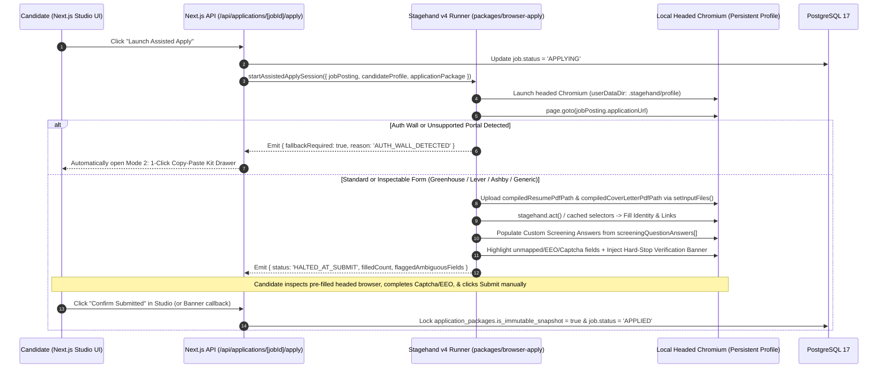
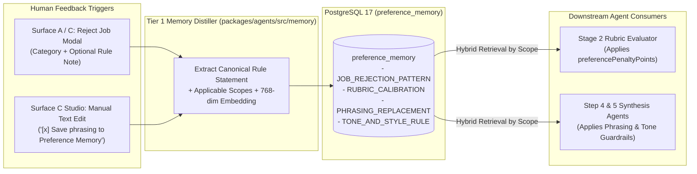

# Session 5 Detailed Design: Stagehand v4 Assisted Apply & Continuous Feedback Loop (`packages/browser-apply`)

**Status:** Finalized & Approved (v2.0 — 3-Mode Stagehand Execution: Local Bridge, Browserbase Live View, & Copy Kit)  
**Parent Spec:** [spec.md](file:///Users/amirhf/job_assist/spec.md)  
**Prerequisite Designs:** [session-1-database-and-career-graph.md](file:///Users/amirhf/job_assist/docs/design/session-1-database-and-career-graph.md), [session-2-ingestion-and-rubric-scoring.md](file:///Users/amirhf/job_assist/docs/design/session-2-ingestion-and-rubric-scoring.md), [session-3-watchable-generation-and-typst.md](file:///Users/amirhf/job_assist/docs/design/session-3-watchable-generation-and-typst.md), [session-4-nextjs-surfaces-and-studio.md](file:///Users/amirhf/job_assist/docs/design/session-4-nextjs-surfaces-and-studio.md)  
**Target Package:** `packages/browser-apply` (Stagehand v4 + Playwright local runner) and `packages/agents/src/memory/` (Preference Memory distillation & retrieval loop)

---

## 1. Non-Spammy Assisted Apply Architecture



---

## 2. Stagehand v4 3-Mode Execution Architecture (`packages/browser-apply/src/`)

To ensure `apps/web` can be deployed statelessly to **Vercel, Railway, or Fly.io** without bundling `400 MB` Chromium binaries or failing when no local X11/macOS display is attached to the cloud server, `packages/browser-apply` supports 3 configurable execution modes (`STAGEHAND_EXECUTION_MODE`):

1. **`local-bridge` (Default Hybrid Mode — $0 Cloud Cost + Local Residential IP):**
   - A lightweight companion CLI (`pnpm apply:companion` listening on `http://127.0.0.1:43110`) runs on the candidate's laptop.
   - When the user clicks **"Launch Assisted Apply"** in the web UI (whether hosted on `localhost:3000` or `https://jobs.yourdomain.com`), the browser sends the signed `AssistedApplyPayload` (including the base64-encoded PDFs from `application_packages`) to `http://127.0.0.1:43110/apply`.
   - The local daemon writes the PDFs to a temp file, launches headed Chromium with the candidate's persistent profile (`.stagehand/persistent-profile`), pre-fills the form, and halts at Submit.
2. **`browserbase` (100% Cloud Mode — Interactive Live View Iframe):**
   - Initializes `new Stagehand({ env: 'BROWSERBASE' })` on the server, pre-fills the form in a stealth cloud browser, and returns Browserbase's interactive `liveViewUrl` to the Next.js Studio modal so the user can review fields, complete Captcha/EEO, and click Submit directly inside an embedded iframe from any device.
3. **`copy-kit-only` (Zero-Compute Fallback):**
   - Opens the `CopyPasteApplyKitDrawer` directly in the browser with 1-click copy buttons and draggable PDF chips.

### 2.1 Package Structure
```text
packages/browser-apply/
├── src/
│   ├── cli-companion.ts              # Local HTTP/WebSocket bridge on 127.0.0.1:43110 for cloud-hosted web UIs
│   ├── runner.ts                     # Stagehand v4 initialization (LOCAL or BROWSERBASE), profile, & lifecycle
│   ├── adapters/
│   │   ├── base-adapter.ts           # Shared file upload, identity mapping, & submit-blocker guard
│   │   ├── greenhouse-adapter.ts     # Fast-path + Stagehand observe/act for boards.greenhouse.io
│   │   ├── lever-adapter.ts          # Adapter for jobs.lever.co
│   │   ├── ashby-adapter.ts          # Adapter for jobs.ashbyhq.com
│   │   └── generic-stagehand.ts      # Self-healing accessibility-tree adapter for custom portals
│   ├── overlay/
│   │   └── verification-banner.ts    # DOM overlay injected into headed browser + submit button interceptor
│   └── types.ts
└── package.json
```

### 2.2 Stagehand v4 Configuration & Safety Guardrails (`runner.ts`)

```typescript
// packages/browser-apply/src/runner.ts
import { Stagehand } from '@browserbasehq/stagehand';
import path from 'node:path';
import type { AssistedApplyPayload, AssistedApplyResult } from './types';
import { selectAtsAdapter } from './adapters';
import { injectHardStopVerificationOverlay, installSubmitButtonBlocker } from './overlay/verification-banner';

export async function runStagehandAssistedApply(
  payload: AssistedApplyPayload
): Promise<AssistedApplyResult> {
  const stagehand = new Stagehand({
    env: 'LOCAL',
    enableCaching: true, // Caches accessibility-tree selector mappings per ATS domain
    modelName: 'gemini-3.5-flash', // Fast, low-cost model for DOM observe()/act()
    localBrowserLaunchOptions: {
      headless: false, // ALWAYS headed so the candidate has full visual control
      userDataDir: path.resolve(process.cwd(), '.stagehand/persistent-profile'),
      viewport: { width: 1440, height: 960 },
      args: ['--disable-blink-features=AutomationControlled'],
    },
  });

  await stagehand.init();
  const page = stagehand.page;

  // 1. Install strict safety interceptor: prevent any programmatic click on final Submit buttons
  await installSubmitButtonBlocker(page);

  await page.goto(payload.jobPosting.applicationUrl, {
    waitUntil: 'domcontentloaded',
    timeout: 20000,
  });

  // 2. Select specialized ATS adapter or generic Stagehand accessibility-tree adapter
  const adapter = selectAtsAdapter(payload.jobPosting.atsPlatform, stagehand);

  // 3. Execute pre-fill steps: File Uploads -> Identity Fields -> Custom Screening Questions
  const fillReport = await adapter.preFillApplication(payload);

  // 4. Highlight ambiguous/unfilled fields (e.g., EEO disclosures, Captchas, salary expectations not in Q&A)
  //    and render the floating top-of-page Verification Banner inside the browser window
  await injectHardStopVerificationOverlay(page, {
    companyName: payload.jobPosting.companyName,
    jobTitle: payload.jobPosting.title,
    filledFieldsCount: fillReport.filledFields.length,
    ambiguousFieldsFlagged: fillReport.ambiguousFields,
    specialInstructionsChecklist: payload.jobPosting.specialInstructions,
  });

  // Note: We intentionally leave the headed browser window OPEN for the candidate to review and click Submit.
  return {
    status: 'HALTED_AT_SUBMIT',
    filledFieldsCount: fillReport.filledFields.length,
    ambiguousFieldsFlagged: fillReport.ambiguousFields,
    haltedAtSubmitAt: new Date().toISOString(),
  };
}
```

---

### 2.3 ATS Field-Mapping Strategy & Self-Healing Prompts (`adapters/`)

1. **Deterministic File Upload (`setInputFiles`):**
   - Before invoking LLM-driven `stagehand.act()` on text inputs (which on some portals triggers an automatic resume parser that overwrites typed fields!), the adapter **always uploads `compiledResumePdfPath` first**, waits 1.5 seconds for any client-side auto-fill script to settle, and then overwrites/populates the remaining fields with our clean verified data.
   - Uses Playwright `page.locator('input[type="file"]').first().setInputFiles(compiledResumePdfPath)` paired with Stagehand `observe("Find the file upload input for Resume/CV and the file upload input for Cover Letter")` when multiple file inputs exist.
2. **Standard Identity & Links Mapping:**
   - Populates `fullName` (or split `firstName` / `lastName`), `email`, `phone`, `locationCity`, `linkedinUrl`, `githubUrl`, `portfolioUrl`, and `workAuthorization` (`authorizedCountries`, `requiresSponsorship`).
3. **Custom Screening Question Population:**
   - Iterates through `applicationPackage.screeningQuestionAnswers`.
   - Uses `stagehand.observe()` to map each `questionLabel` to its exact accessibility tree element and fills `userEditedAnswer ?? draftedAnswer`:
   ```typescript
   await stagehand.act({
     action: 'Fill the application form field labeled %questionLabel% with the exact value %answerValue%. Do not click any submit or finish button.',
     variables: {
       questionLabel: qa.questionLabel,
       answerValue: qa.userEditedAnswer ?? qa.draftedAnswer,
     },
   });
   ```

---

### 2.4 Hard-Stop Guardrail & In-Browser Verification Overlay (`verification-banner.ts`)

To enforce **Core Principle 1 (`Quality Over Spam: The system never auto-submits applications blindly`)**:
1. **Programmatic Submit Blocker:**
   - During the automated pre-fill phase, `installSubmitButtonBlocker(page)` overrides `HTMLFormElement.prototype.submit` and attaches a capture-phase click listener blocking automated clicks on any `<button type="submit">` or element matching `/\b(submit application|send application|apply now|finish)\b/i`.
   - Once the pre-fill script completes and injects the verification banner, the blocker disarms so the **human user's physical mouse click** on the Submit button works normally.
2. **Visual Highlighting & Floating Banner:**
   - Any required field left blank (such as voluntary EEO disclosures, veteran/disability status, or unmapped dropdowns) is outlined with a high-visibility amber glow (`outline: 3px solid #F59E0B; background-color: rgba(245, 158, 11, 0.08)`), and the page scrolls to the first flagged field.
   - A compact floating banner at the top of the viewport summarizes:
     - `Pre-filled 11 fields + Resume.pdf + CoverLetter.pdf`
     - `2 fields highlighted in Amber require your manual selection (EEO / Captcha)`
     - `Automated execution halted. Review all fields and click Submit manually when ready.`

---

## 3. Mode 2: 1-Click Copy-Paste Kit Drawer (`CopyPasteApplyKitDrawer.tsx`)

When a portal requires complex SSO login (e.g., Workday multi-step account creation) or when the user prefers manual form entry, clicking **"Open 1-Click Copy Kit"** in Surface C opens a compact floating companion view alongside the user's browser:

- **Draggable PDF Chips:** Native HTML5 drag-and-drop file chips for `[Resume_AlexRivera_Linear.pdf]` and `[CoverLetter_AlexRivera_Linear.pdf]` plus 1-click **"Reveal in Finder"** and **"Copy File Path"** buttons.
- **Quick-Copy Identity Strip:** 1-click copy pills for `Email`, `Phone`, `LinkedIn URL`, `GitHub URL`, `Portfolio URL`, `Location`.
- **Custom Q&A Copy Cards:** Displays every extracted screening question with its final tailored answer and a single-click **`Copy Answer (Cmd+1..9)`** button that flashes a green checkmark once copied.

---

## 4. Continuous Self-Improvement Loop (`preference_memory`)

The system learns from human actions at two explicit feedback points without polluting prompts with noisy raw logs.



### 4.1 Feedback Ingestion Workflows (`packages/agents/src/memory/preference-service.ts`)

1. **From Job Rejections (`recordJobRejectionMemory`):**
   - Triggered when the candidate rejects a role in Surface A or Surface C and provides a reason/note.
   - Distills a concise rule statement (e.g., *"Penalize roles requiring >25% travel or customer-site deployment implementation"*), sets `preferenceType = 'JOB_REJECTION_PATTERN'`, `applicableScopes = ['RUBRIC_SCORING']`, generates its 768-dim embedding, and stores it in `preference_memory`.
   - If a similar rule already exists (`cosineSimilarity > 0.88`), increments `confidenceWeight = Math.min(1.0, confidenceWeight + 0.15)` rather than inserting a duplicate row.

2. **From Studio Phrasing Edits (`recordStudioPhrasingMemory`):**
   - Triggered when the candidate edits a generated bullet, cover letter paragraph, or screening answer in `/studio/[jobId]` with **"Save phrasing to Preference Memory"** checked.
   - Compares `originalTextSnippet` vs `userEditedTextSnippet` using `TIER_1_INGESTION` (`gemini-3.1-flash-lite`) to extract a reusable writing directive:
     ```typescript
     export const DistilledWritingRuleSchema = z.object({
       preferenceType: z.enum(['PHRASING_REPLACEMENT', 'TONE_AND_STYLE_RULE']),
       ruleStatement: z.string().describe(
         'Clear, actionable instruction for future synthesis, e.g. "Never use the verb spearheaded; use architected, built, or led instead."'
       ),
       applicableScopes: z.array(z.enum(['RESUME_BULLETS', 'COVER_LETTER', 'SCREENING_QA'])),
     });
     ```
   - Saves the rule with `originalTextSnippet`, `userEditedTextSnippet`, and its 768-dim embedding into `preference_memory`, and exposes a **"Learned Preferences"** management tab inside `/profile` where the user can inspect, toggle (`isActive`), or delete any learned rule.
